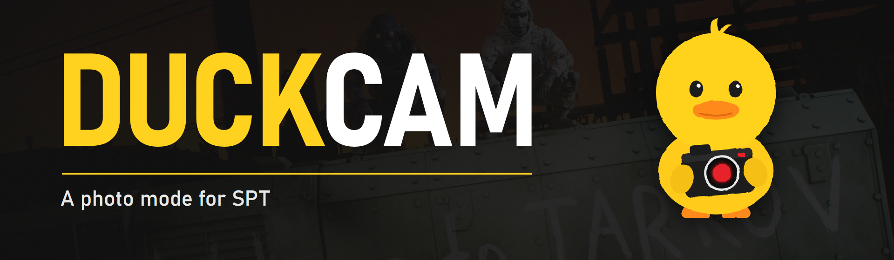

# DuckCam

A photo mode for **SPT 4.1**.

Stop the raid, move the camera anywhere, pose characters and take great screenshots.

**Guide: [duckcam.wiki](https://duckcam.wiki/)**

## What you can do

- Freeze the raid
- Fly the camera anywhere
- Pose characters
- Change clothes and gear
- Add bots
- Change light, time and weather
- Take photos (up to 16K) and record video

## Install

1. Put `DuckCam.dll` in `BepInEx/plugins/DuckCam/` inside your SPT folder.
2. Start a raid.
3. Press **F6**.

## Keys

| Key | What it does |
|---|---|
| F6 | Open or close DuckCam |
| P | Take a photo |
| F11 | Hide or show the menu |
| Ctrl+G | Open the gallery |

You can change every key in DuckCam under **FRAME > Interface > Keybinds**.

## Something broke?

Go to the **DEBUG** tab, press **Copy report**, and send it together with `BepInEx/LogOutput.log`.

## For developers

Copy the game's DLLs from your SPT folder into `src/References/` (see `DuckCam.csproj` for the list), then run:

```bash
dotnet build src/DuckCam.csproj -c Release
```

## Licence

Copyright 2026 Hj. All Rights Reserved. See [LICENSE.md](LICENSE.md).

## Credits

- CD Projekt Red (UI layout)
- Dnc4r/Sage
- psiberx
