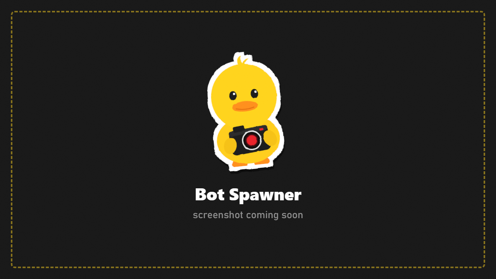

# Bot Spawner

Spawn **real bots** exactly where you click, with the gear and weapons you choose. Works live or frozen.

Open it from **CHARACTERS > Spawn Bots > Open Spawner**.

## Spawn a bot

1. **Pick a role:** PMC (USEC or BEAR), scavs, bosses and their followers, raiders, rogues, cultists, infected, and modded factions (from MoreBots, or seen in this raid).
2. **Check the preview.** A live model wears the bot's gear; drag it to turn it.
3. **Change gear (optional):** click a slot and pick an item from the **Item Database** (every item in the game, modded included, with icons and search). Each slot only lists items that fit it. Armor comes with its default plates.
4. **Weapons** come from **your saved weapon presets** and the default presets, so they're always complete. They spawn with a loaded magazine, a round chambered, and spare magazines (or loose rounds for tube-fed guns).
5. Press **Spawn**. The window steps aside and a marker follows your mouse:
   - **Green:** a safe spot (floor, walkable, room to stand).
   - **Red:** not allowed, with the reason shown.
6. **Click** to place the bot. **Shift+click** keeps placing more.

Bots spawned while frozen join the frozen scene and stand still until you unfreeze.

## Options

| Option | What it does |
|---|---|
| **Infinite Ammo** | Spare magazines refill every second. The bot still reloads but never runs dry |
| **Only in this session** | Living spawned bots are removed when you leave DuckCam. Untick it to keep them in the raid |

## Kits

Save a role and its gear as a **kit** to reuse it.
1. Set up the bot.
2. Save it as a kit with a name. Mark favourites to find them quickly.
3. Load a kit and spawn **several bots** from it at once, for example a whole squad in matching gear.

Kits are stored in `SPT/DuckCam/Kits/` and can be shared.

## Add To Photo (photo-only bots)

**CHARACTERS > Add Any Bot (photo only)** opens the same window. Build any bot (any role or faction) and press **Add To Photo**: it appears as a **posable character only**, with no AI and not part of the raid. Pose, move and re-dress it in [Characters](Characters.md). From a live scene, the scene freezes when you place it.

## Good to know

- Bots use the game's own spawner with a server-generated profile, so they behave like normal bots.
- Another mod's bot handlers (for example MoreBotsAPI) may log a warning when DuckCam spawns a bot; DuckCam catches it and carries on.
