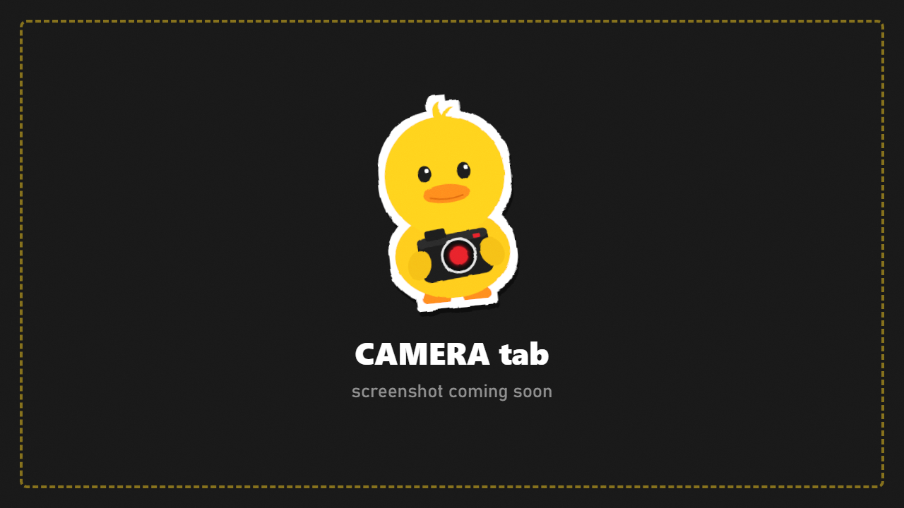

# Camera

Where the camera is, how it moves, and what it can see.

DuckCam takes over the game's real camera, so Tarkov's own post-processing, level of detail, culling and streaming all follow it. What you see is what the game renders.

## Camera Type

| Type | What it does |
|---|---|
| **Free** | Fly anywhere with WASD, R/F and the mouse |
| **Orbit PMC** | Circle around your character; the mouse orbits, the wheel changes the distance |
| **Tripod** | The camera stays put; you only turn it |
| **First Person** | Ride at a character's eyes (pick who below) |

## View From A Player

Watch any player or bot through their own eyes, or orbit them.

1. **Player:** pick someone from the list (nearest first).
2. Press **Their Eyes** for first person (their head is hidden so it doesn't block the view) or **Orbit Them** for third person.
3. In a live session they keep moving and the camera follows. While frozen they hold still.

## Lens

| Row | What it does |
|---|---|
| **Field of View** | How wide the camera sees. The mouse wheel changes it too |
| **Rotate** | Roll the camera (tilt the horizon) |
| **Horizon Lock** | Keeps the horizon level while you fly |
| **Near Clip / Far Clip** | How close and how far the camera draws. Lower Near Clip to get very close to a face |

Tip: most portraits look better with a low Field of View. Zoom all the way in first, then move back until the subject fits.

## Limits

| Row | What it does |
|---|---|
| **Movement Radius** | How far the camera may go from your PMC: 100 to 1000 m, or **Unlimited** |
| **Collision** | **Off** flies through walls, **Soft** slides along them, **Strict** stops at them |

## Detail and culling

| Row | What it does |
|---|---|
| **LOD Boost** + **LOD Distance Factor** | Keeps high-detail models further away. Good for wide shots |
| **BSG Culling Off** | Stops the game hiding objects it thinks are out of view. Try it if things pop in or vanish |
| **Interior Culling** | Shows whether the indoor culling follows the camera (it does by default) |

## Bookmarks

Nine camera spots you can jump between.
- Click an **empty** slot to store the current camera spot there.
- Click a **filled** slot to jump back to it. **Shift+click** overwrites it.
- Keys: **Alt+1 to Alt+9** jump, **Alt+Shift+1 to Alt+Shift+9** store.

Bookmarks last for the current raid. To keep camera positions, use [scene presets](Presets.md) or [paths](Paths-and-Timeline.md).
