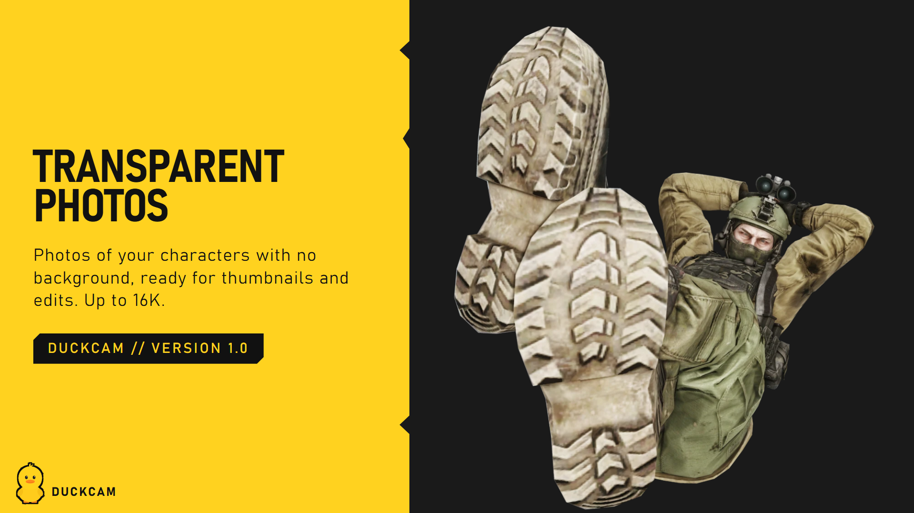
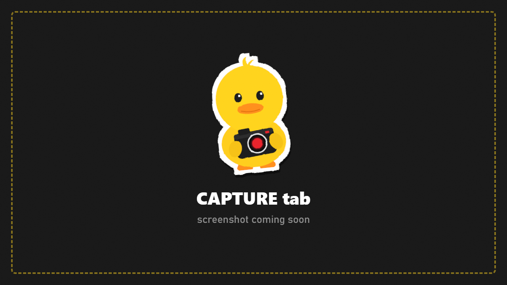

# Capture

Photos (screen size to 16K, optional transparent background) and video.

## Take a photo

- **P** any time, **Space** with the menu open, or **Take Screenshot** here.
- The UI is hidden automatically. Grids and focus planes never appear.
- Saved as PNG in `Your-SPT-Folder/DuckCam/Screenshots/` with a name like `DuckCam_2026-10-28_13-09-09_Factory_008.png`.
- **JSON Sidecar** also saves a small file with the map, camera and characters.
- **Last Photo** shows where the latest one went.

## Resolution

| Row | What it does |
|---|---|
| **Photo Resolution** | From **Screen** up to **16K** |
| **Anti-Alias Supersample** | Renders bigger and shrinks down for smoother edges |
| **Output** | The final size in pixels |

Photos bigger than your screen are built from several **tiles**: the camera zooms into each part of the picture in turn, and DuckCam stitches them together. The screen steps through the tiles for a few seconds; keep the scene frozen while it does. Vignette, grain and chromatic aberration are switched off for tiled photos (they would repeat in every tile), and the exposure is held so every tile matches.

## Transparent background

| Row | What it does |
|---|---|
| **Transparent Background** | Keep only the characters, everything else transparent |
| Subjects | **All Characters** or **Photo Characters Only** |
| **Keep Scene Shadows** | Keep the shadows characters cast on the ground |

Great for thumbnails, edits and wallpapers. See [the guide](Guides.md#9-16k-photos-and-transparent-backgrounds).

## Video

DuckCam records MP4 with game audio through **FFmpeg** (see [Installation](Installation.md#video-recording-optional)). **FFmpeg** shows whether it was found.

| Row | What it does |
|---|---|
| **Record Video** (Ctrl+F12) | Start / stop |
| **Frame Rate** | 24 to 240 fps |
| **Resolution** | Video size |
| **Encoding** | Quality and encoding speed |
| **Record Game Audio** | Include the game's sound |
| **Flip Vertically** | Fix upside-down video on some setups |

The game clock is locked to the video frame rate while recording, so the video is always smooth, even if your PC can't keep up in real time. The speakers stay silent while recording. Combine it with a [camera path](Paths-and-Timeline.md) or the [animation timeline](Paths-and-Timeline.md#animation-timeline-ctrlt).
