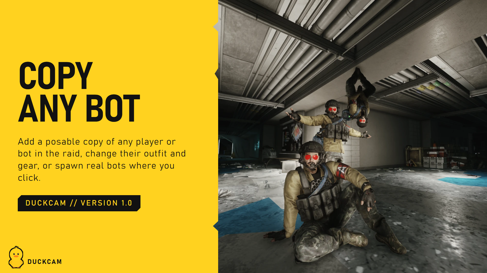
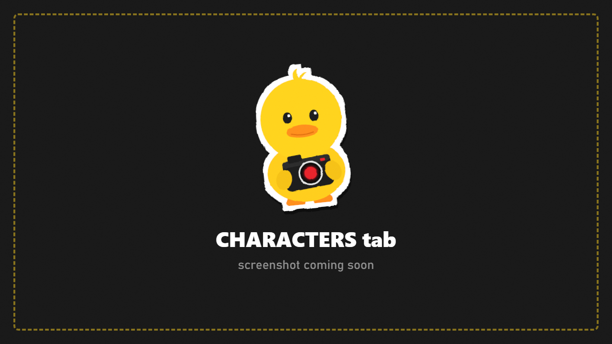

# Characters

Put people in your shot: posable copies of your PMC and of anyone in the raid, poses, look direction, weapons, and bots.

## How characters work

DuckCam characters are **photo copies**: display-only models that look exactly like the original (body, outfit, gear, weapon) but are controlled only by DuckCam. Your real PMC and the real bots are never changed. That's why posing, outfit changes and gear swaps can never affect your raid or your inventory.

Characters need a **frozen** scene. If you're in a live session, **Freeze Raid** freezes it first.

## Add a character

The **Characters** row shows a portrait slot per character, plus **+** slots for adding more (up to the limit).

| Option | What you get |
|---|---|
| **Your PMC > Add** | A copy of you, in your exact **raid stance** and holding your weapon. Your real PMC is hidden while the copy stands in its place |
| **Players in this raid** | A copy of any player or bot, nearest first. **Faction** filters the list (modded factions are detected automatically) |
| **Spawn At** | Where the copy appears: at the original's spot, or where the camera looks |
| **Hide Original** | Hide the real player or bot while its copy is there |
| **Saved characters** | Bring back a character you saved earlier (outfit, gear and pose) |
| **Add Any Bot (photo only)** | Build any bot in the [Bot Spawner](Bot-Spawner.md) and add it as a posable character with no AI |

**Edit Character** picks which character the rows below change.

## Pose

Pick a **Library**:

### Gear Rack Poses
The Hideout mannequin poses, plus poses from other mods (shown as `[mod]`). **Category** filters:

| Category | Shows |
|---|---|
| **All** | Everything |
| **Favorites** | Poses you starred with **Favorite Pose** |
| **Unlocked** | Only poses unlocked on your profile |
| **From Mods** | Poses added by other mods (for example choccy's Custom Mannequin Poses) |
| **DuckCam** | Your own saved poses |

**Clip Time** picks the moment in the animation.

### Body Animations
The game's own in-raid animations as poses: idle, crouch, prone, aiming, walking, reloading, leaning, throwing, injured, interactions and more. DuckCam tests each one on the character and groups them by name. Some only move the upper body or legs; turn on **Show Partial Body** to see those too. Picking one starts halfway through the animation so you see the action, and **Clip Time** moves through it.

### Raid stance
A copy of your PMC (or a bot) starts in **the exact stance it had in the raid**, weapon and hands included. After trying other poses, **Raid Stance > Restore** brings it back.

### Pose Bone By Bone
**Pose Editor** opens [Pose Mode](Pose-Mode.md): rotate any bone, use IK, mirror, save poses.

## Position

| Row | What it does |
|---|---|
| **Rotate** | Turn the character around |
| **Left / Right** | Move it left or right **as seen from the camera** |
| **Close / Far** | Move it toward or away from the camera |
| **Up / Down** | Raise or lower it |
| **Move To Where Camera Looks > Place** | Put it where the centre of the screen points |
| **Reset Offsets** | Back to where it started |

## Look and fine controls

| Row | What it does |
|---|---|
| **Look Target** | Make the head follow the camera, another character, or a point |
| **Look Point** | Set the point it looks at |
| **Look Range** | How far the head may turn |
| **Fine Pose Controls** | Shows head turn, nod and tilt sliders |
| **Turn Body To Look Target** + **Strength** | Turn the upper body toward the look target too |
| **Bones, Hands And Feet (IK)** | Opens Pose Mode for detailed posing |
| **Fine Controls > Reset** | Clears the fine controls |

## Weapons

| Row | What it does |
|---|---|
| **Weapon In Hands** | Show or hide the character's weapon |
| **Hand Weapon** | **Main / Pistol / Knife**: which weapon from its slots it holds (shown when it has more than one) |
| **Hide My PMC's Weapon** | Hide the weapon in your real PMC's hands (live and frozen) |
| **Hide Bots' Weapons** | Hide the weapons in every bot's hands |
| **Photo Characters: Hide All / Show All** | Hide or show every photo character at once |

The character's weapons come from its **equipped slots** (Primary, Second, Holster, Melee), not from backpacks or the stash. Change them in [Outfit and Gear](Outfit-and-Gear.md) with the Item Database.

When you pose an arm, the weapon follows the right hand. In Pose Mode, **WEAPON GIZMO** moves and rotates the weapon itself.

## Other rows

| Row | What it does |
|---|---|
| **See Through Their Eyes > First Person** | Look through this character's eyes. Pose them and the view follows the head |
| **Animate Poses Over Time** | Opens the [animation timeline](Paths-and-Timeline.md#animation-timeline-ctrlt) |
| **Character Visible** | Hide this character without removing it |
| **Surrounding NPCs** | Hide every real bot nearby for a clean shot |
| **Clothes & Gear > Edit** | Jump to [Outfit and Gear](Outfit-and-Gear.md) |
| **Save** | Save this character (outfit, gear, pose, edits) to `Your-SPT-Folder/DuckCam/Actors/` |
| **Remove** | Remove this character |

## Saved poses

**Save As** + **Save Current Pose** saves the character's whole current pose. It then appears under **Category > DuckCam** for every character. Poses are plain files you can share ([Making Content](Making-Content.md)).

## Spawn real bots

**Spawn Bots > Open Spawner** opens the [Bot Spawner](Bot-Spawner.md) for real, AI-driven bots.
