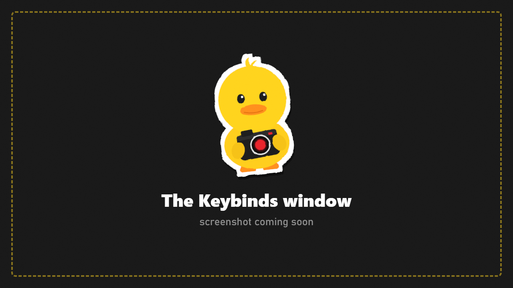

# Controls and Keybinds

Every key works on a keyboard **without a numpad** (TKL) and on non-US layouts. Every key can be changed: **FRAME > Interface > Keybinds** (in game) or the **F12 Configuration Manager**.

## Always

| Key | Action |
|---|---|
| **F6** | Open DuckCam **frozen** / leave. Inside a live session: freeze / unfreeze |
| **F5** | Open DuckCam **live** (the raid keeps running) / snap back and close |
| **F9** | Freeze bots only (in or out of DuckCam) / release them |
| **F11** | Show / hide the DuckCam menu |
| **P** | Take a photo |
| **Ctrl+F12** | Start / stop video recording |
| **Ctrl+Tab** or **Ctrl+P** | Enter / leave Pose Mode |
| **Ctrl+T** | Open / close the animation timeline |
| **Ctrl+Space** | Play / pause the animation timeline |

## With the menu open

| Key | Action |
|---|---|
| **Q / E** (or PgUp / PgDn) | Previous / next tab |
| **Up / Down** | Select a row |
| **Left / Right** | Change the value |
| **Enter** | Press the row's button |
| **W A S D**, **R / F** | Fly the camera, up / down |
| Hold **right mouse button** | Look around |
| **Mouse wheel** | Field of view, or scroll the menu when the pointer is over it |
| **Space** | Take the photo |
| **Tab** | Hide the menu |
| **Esc** | Leave DuckCam (asks first) |

## With the menu hidden (KappaCam layout)

| Key | Action |
|---|---|
| **W A S D** or arrow keys | Move |
| **Space / Ctrl** | Up / down |
| **Shift / Alt** | Fast / precise |
| **Q / E** | Roll the camera |
| **Backspace** | Reset rotation |
| **Mouse5 + wheel** | Movement speed |
| Hold **Mouse4** | Smooth zoom |
| **F / T** | Orbit your PMC / tripod lock (frozen) |
| **Tab** | Show the menu again |

## Cinematic

| Key | Action |
|---|---|
| **F1** | Live session: switch mouse and keys between the camera and your PMC |
| **F4** | Slow motion on / off (live) |
| **F7 / F8** | Attach the camera to what it looks at / detach |
| **Home / End / Shift+Home** | Camera memory: add a spot / go to the next / clear |
| **Alt+1 to Alt+9** | Jump to camera bookmark 1-9 |
| **Alt+Shift+1 to Alt+Shift+9** | Store camera bookmark 1-9 |
| **F2 / Shift+F2 / F3** | Camera recording: record or stop / continue / play or stop |

## Paths

| Key | Action |
|---|---|
| **Insert** | Add a keyframe at the end |
| **Shift / Alt / Ctrl + Insert** | Insert after / insert before / replace the selected keyframe |
| **Delete** | Delete the selected keyframe |
| **Ctrl + PgUp / PgDn / Home / End** | Previous / next / first / last keyframe |
| **Alt+1 to Alt+9** (while a path plays) | Cut to path 1-9 at the same progress |

## Pose Mode

Pose Mode uses **Blender 5.1's default Pose Mode keys**. The full list is on the [Pose Mode](Pose-Mode.md#shortcuts) page, and **F1** shows it in game.

## Changing a key

1. Go to **FRAME** (press **E** until you reach it, or click its icon).
2. Under **Interface**, press **Keybinds**.
3. Click the key you want to change and press the new key. Hold Ctrl, Shift or Alt for a combination.
4. If another DuckCam key **or another mod's config** already uses it, the window tells you which. Press **SAVE** to keep it anyway, or pick another key.

> **Tip:** F5 to F9, Insert, Home, End and Delete are popular with other mods. If a DuckCam key does nothing or triggers something else, another mod probably uses it too. Rebind one of them.
