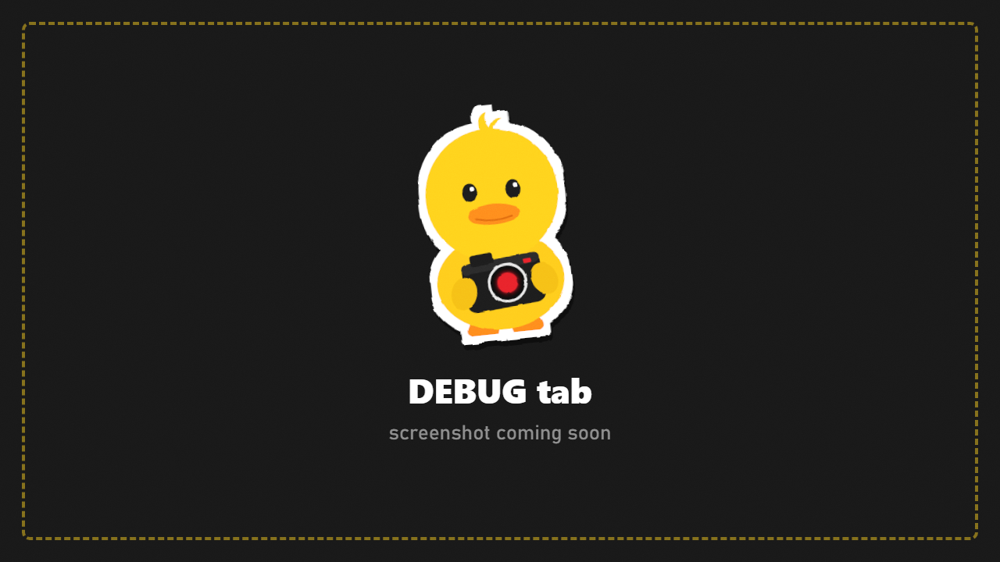

# Debug

Tools for when something doesn't work.

## Report a problem

1. Set **Log level** to **Verbose**.
2. Do the thing that goes wrong again.
3. Press **Copy Report**. A full report is copied to your clipboard.
4. Paste it in your bug report together with `SPT/BepInEx/LogOutput.log`.

The report lists every freeze layer, every patch DuckCam installed (a failed one shows as `FAIL <id> [feature] <reason>`), the camera, culling, effects found, environment and character data.

## Other tools

| Button | What it does |
|---|---|
| **Scan Visibility** | Lists what is hidden or culled in view |
| **Rig Probe** | Checks a character's skeleton |
| **Simulate Failure** | Tests that DuckCam restores everything after an error |

See also [Troubleshooting and FAQ](Troubleshooting-and-FAQ.md).
