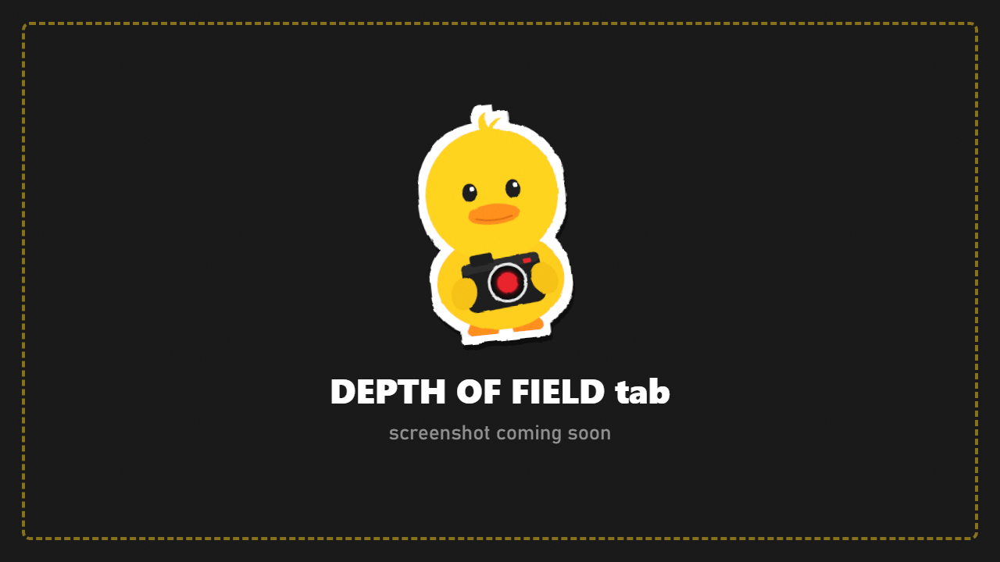

# Depth of Field

Blur the background (or foreground) like a real camera lens.

## Live depth of field

1. Turn on **Depth of Field**.
2. Pick a **Focus Mode**:

| Focus Mode | Focuses on |
|---|---|
| **Manual** | The distance you set |
| **Screen Center** | Whatever is in the middle of the screen (autofocus) |
| **Your PMC** | Your character |
| **Attached Target** | What the camera is attached to (F7) |

3. Adjust:

| Row | What it does |
|---|---|
| **Aperture** | Lower = more blur, like a wide-open lens |
| **Focus Range** | How deep the sharp zone is |
| **Max Blur** | Caps how blurry far things get |
| **Foreground Blur** | Also blur things in front of the focus |
| **Show Focus Plane** | Highlights exactly what is sharp while you adjust. Never appears in photos |

## Lens render (frozen scenes)

A slower, better depth of field: DuckCam renders the frozen scene many times from slightly different points on a virtual lens and blends them. The result is real bokeh: round highlights and natural blur at edges.

1. Freeze the raid and set up your shot.
2. Set **Lens Radius** (bigger = stronger blur) and **Highlight Boost** (brighter bokeh balls).
3. **Samples** shows how many frames it will take.
4. Press **Render DoF Photo**. The screen steps through the frames for a few seconds; keep still.
5. **Last Render** shows where it was saved.

> The lens render needs a frozen scene. Anything moving would smear.
