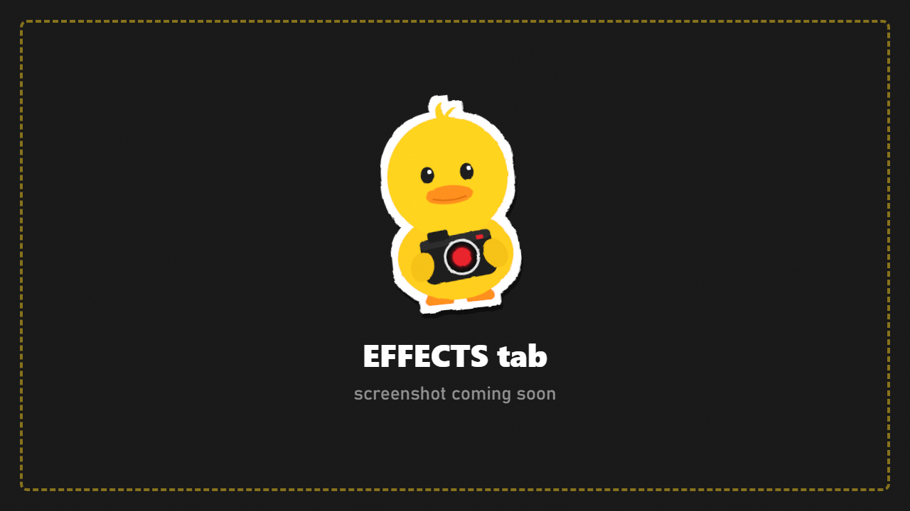

# Effects

Colour, contrast and lens effects. DuckCam only shows effects the game actually renders on your setup, so every control does something.

## Presets

**Preset** applies a complete look in one step. There are 32, including:

Filmic, Noir, Cinematic, Golden Hour, Bleak Winter, Horror, Lomo, Retro 80s, Night Vision, Thermal and more.

Every slider below stays adjustable after picking a preset.

## Filter

**Filter** puts one of the game's **27 built-in colour filters** on top of the preset.

## Fine-tuning

| Group | Controls |
|---|---|
| Image | Brightness, saturation, clarity, colorfulness, sharpen |
| Lens | Vignette, chromatic aberration, grain, bloom, lens distortion |
| Colour | Exposure, contrast, temperature, tint |
| Curves | Lift / gamma / gain per colour channel |

**Reset Effects** goes back to the game's normal look.

## My Filters

Save your current look under a name to use it again later.

1. Set up the look you like.
2. Type a name in **Filter Name**.
3. Press **Save Look As Filter**.

Your filter appears in the **Preset** list with a star. It's stored as a file in `Your-SPT-Folder/DuckCam/Filters/`, so you can share it ([Making Content](Making-Content.md)).

> Effects are always restored when you leave DuckCam, so your raid looks normal again.
