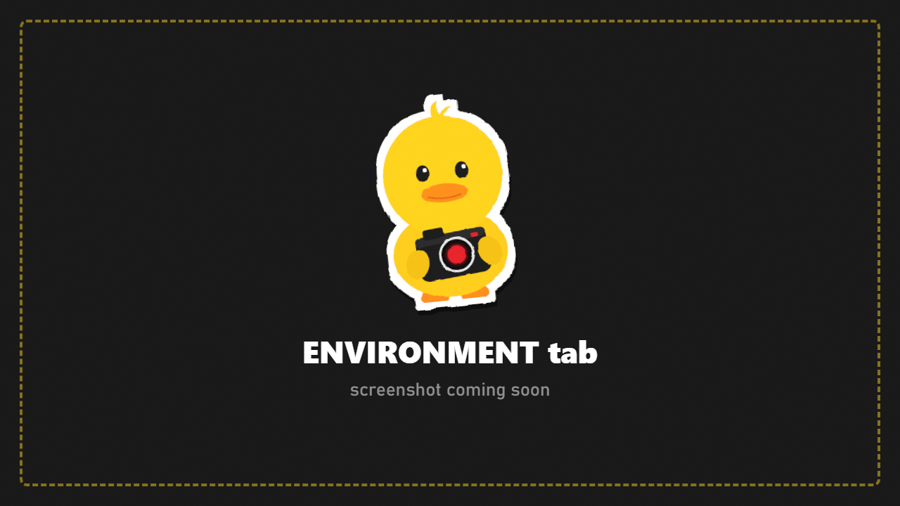

# Environment

Time of day and weather.

## Time of day

| Row | What it does |
|---|---|
| **Current Time** | The raid's time right now |
| **Time of Day** | Slide to any hour |
| **Time Preset** | Dawn, sunrise, noon, golden hour, dusk, midnight and more |
| **Keep Time After Exit** | Keep the new time when you leave DuckCam (otherwise it goes back) |

## Weather

1. Turn on **Weather Override**.
2. Pick a **Weather Preset** (from Clear to Storm), or set each part:

| Row | What it does |
|---|---|
| **Clouds** | Cloud cover |
| **Fog** | Fog density |
| **Rain** | Rain strength |
| **Lightning** | Lightning frequency |
| **Wind** + **Wind Direction** | Wind strength and direction |
| **Temperature** | Air temperature |

3. **Keep Weather After Exit** keeps it when you leave.

> **Factory, Labs and the Hideout have no dynamic weather** in Tarkov, so the weather rows say "Not on this map" there. Time of day still works where the map has a clock.
