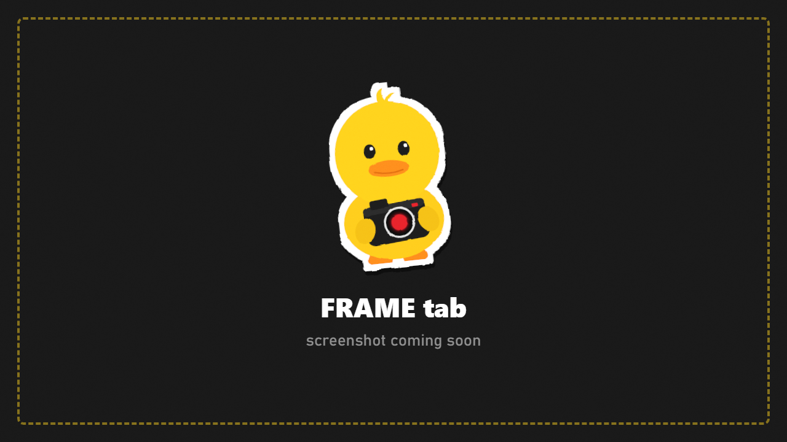

# Frame

Composition helpers, aspect ratios, and the interface settings.

## Composition

| Row | What it does |
|---|---|
| **Grid** | Rule of thirds, golden ratio, centre cross, diagonals or safe area |
| **Grid Opacity** | How visible the grid lines are |
| **Grid When UI Hidden** | Keep the grid while the menu is hidden |
| **Horizon Line** | A level line to straighten your shot |

The grid and horizon line **never appear in photos**.

## Aspect ratio

| Row | What it does |
|---|---|
| **Frame** | 16:9, 21:9, 2.39:1, 4:3, 1:1, 4:5, 9:16 and more. Black bars show the frame |
| **Letterbox Opacity** | How dark the bars are |
| **Crop Photo To Frame** | Save exactly the area inside the frame |
| **Photo Size** | The size the photo will be saved at |

## Interface

Colour scheme, panel side, UI scale, HUD decorations, edge glow, controls legend, **Tabs** (show or hide tabs), **Keybinds** (change any key), **Language** and the **Beginner Guide**. See [The Menu](The-Menu.md#interface-settings-frame--interface).
