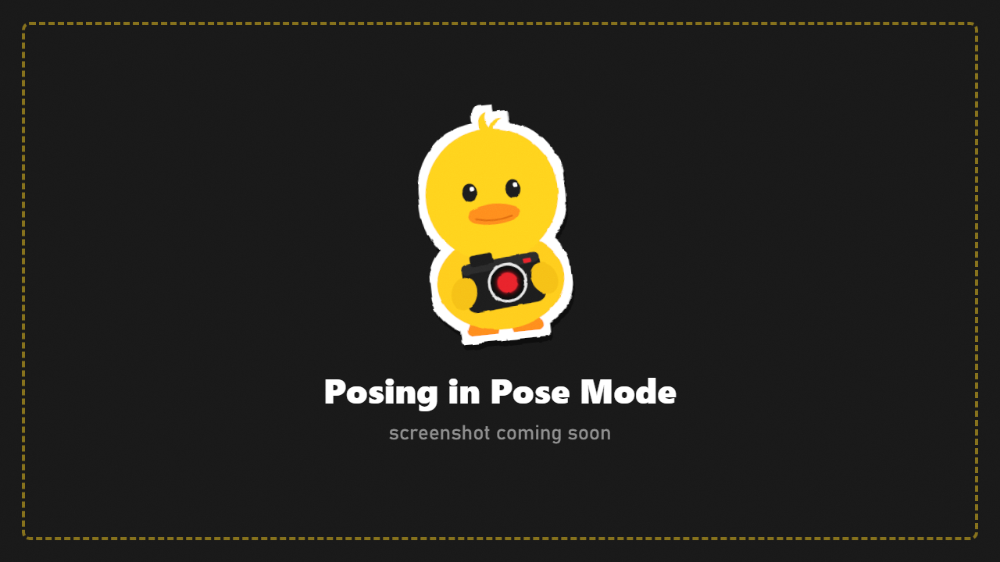
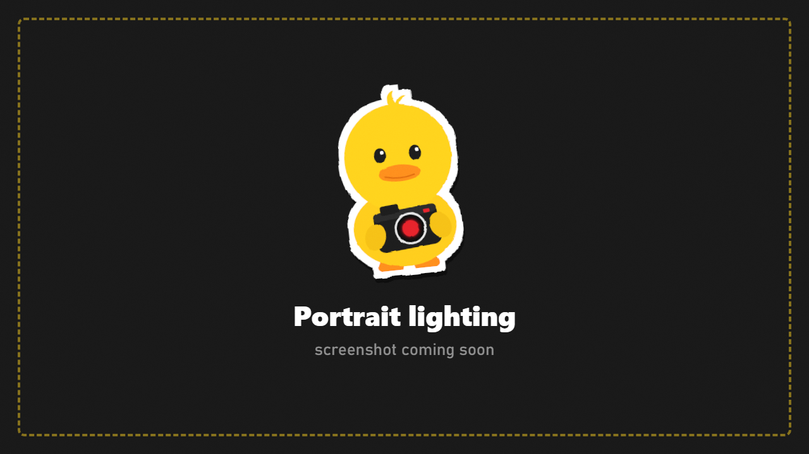
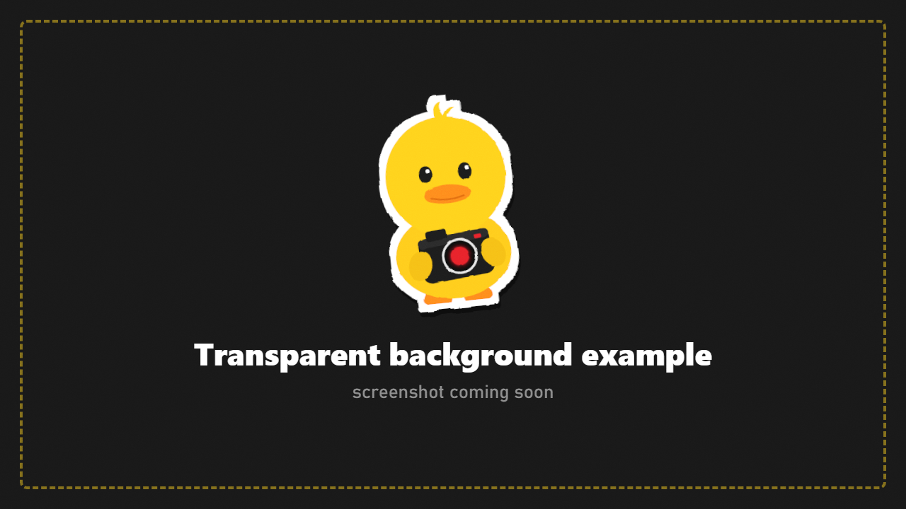
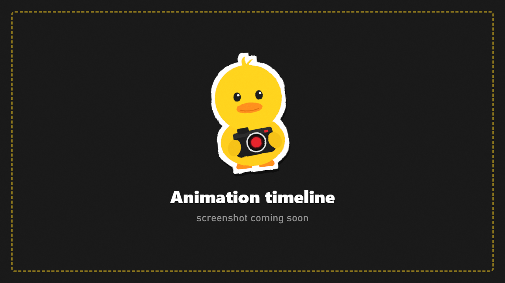

# Step-by-Step Guides

Hands-on recipes from your first photo to animated scenes. Each one lists what you need and every step.

1. [Your first great photo](#1-your-first-great-photo)
2. [Pose your PMC](#2-pose-your-pmc)
3. [Catch bots mid-action](#3-catch-bots-mid-action)
4. [A squad photo with real bots](#4-a-squad-photo-with-real-bots)
5. [Build a scene with photo-only characters](#5-build-a-scene-with-photo-only-characters)
6. [A moody portrait with lights and depth of field](#6-a-moody-portrait-with-lights-and-depth-of-field)
7. [A smooth camera move video](#7-a-smooth-camera-move-video)
8. [Action shots in a live raid](#8-action-shots-in-a-live-raid)
9. [16K photos and transparent backgrounds](#9-16k-photos-and-transparent-backgrounds)
10. [Animate a scene with the timeline](#10-animate-a-scene-with-the-timeline)
11. [Give a character a different weapon](#11-give-a-character-a-different-weapon)
12. [Save a setup and reuse it](#12-save-a-setup-and-reuse-it)
13. [Make your own photo frame](#13-make-your-own-photo-frame)

---

## 1. Your first great photo {#1-your-first-great-photo}

**You need:** any raid.

1. Find a spot with nice light and press **F6**. The raid freezes.
2. Fly the camera with **WASD**, **R/F** and the **right mouse button**. Get low: shots from knee height look more dramatic.
3. Zoom with the **mouse wheel**. A narrower field of view (zoomed in) flattens the background and looks more cinematic.
4. Go to **FRAME** and turn on a **Grid** (rule of thirds). Put your subject on one of the lines, not in the middle.
5. Go to **EFFECTS** and try **Preset** looks. *Filmic* and *Cinematic* are good starting points.
6. Optional: **DEPTH OF FIELD** > turn it on, **Focus Mode: Screen Center**, lower the **Aperture** until the background softens.
7. Press **Tab** to hide the menu, then **P**.

Your photo is in `Your-SPT-Folder/DuckCam/Screenshots/`.

---

## 2. Pose your PMC {#2-pose-your-pmc}

**You need:** a raid. A weapon in your hands makes it more interesting.

1. Press **F6** to freeze.
2. Go to **CHARACTERS** and press **Your PMC > Add**. A copy of you appears in your exact raid stance with your weapon, and your real PMC is hidden.
3. Pick a pose:
   - **Library: Gear Rack Poses** for mannequin poses (and poses from other mods, marked `[mod]`).
   - **Library: Body Animations** for the game's own animations: crouching, aiming, reloading, leaning... Use **Clip Time** to pick the exact moment.
4. Move it into place with **Rotate**, **Left / Right**, **Close / Far** and **Up / Down**. Left and right follow your camera, so "Right" moves it to the right of your screen.
5. Make it look at you: **Look Target: Camera**.
6. For full control press **Pose Bone By Bone > Pose Editor** ([Pose Mode](Pose-Mode.md)):
   1. Click a bone, press **R**, move the mouse, left click to keep it.
   2. Press **X**, **Y** or **Z** while rotating to lock an axis. Type **45** for exactly 45 degrees.
   3. Pose one arm, select it, **Ctrl+C**, then **Ctrl+Shift+V** to mirror it onto the other arm.
   4. **Ctrl+Z** undoes. **RESET ALL** (twice) goes back to the raid stance.
   5. Type a name under **LIBRARY** and press **SAVE NEW** to keep the pose.
   6. **Ctrl+Tab** leaves Pose Mode.
7. Hide the menu (**Tab**) and press **P**.

> Changed your mind? **Raid Stance > Restore** brings back the stance you had in the raid.

---

## 3. Catch bots mid-action {#3-catch-bots-mid-action}

**You need:** a raid with bots nearby.

**Option A: freeze everything**
1. When the action happens, press **F6**. Bullets, bodies and bots stop exactly where they are.
2. Fly around and find the angle.
3. To nudge the moment forward: **TIME > Frame Step Count** (try 1 to 5) and press **Step Frames**.

**Option B: freeze only the bots**
1. Press **F9**. Every bot stops in its exact pose, but you and the world keep going.
2. Walk right up to them for a close-up, in first person or with DuckCam (F5 or F6).
3. Press **F9** again to release them. Get out of their sight first; they react to what they can see.

**Option C: copy a bot**
1. Freeze with **F6**.
2. **CHARACTERS** > **Players in this raid** > pick the bot. A copy appears in the same pose, holding its weapon. Turn on **Hide Original** to hide the real bot.
3. Now you can move, turn and re-pose the copy freely.

---

## 4. A squad photo with real bots {#4-a-squad-photo-with-real-bots}

**You need:** a raid with some open space.

1. Press **F6** to freeze.
2. **CHARACTERS > Spawn Bots > Open Spawner** ([Bot Spawner](Bot-Spawner.md)).
3. Pick a role, for example **PMC USEC**.
4. Dress them: click a slot, pick from the **Item Database**. Pick a weapon from your presets.
5. Save it as a **kit** so the whole squad matches.
6. Press **Spawn**. A green marker follows your mouse. **Shift+click** to place several bots in a row. Red means the spot isn't safe; the reason is shown.
7. Close the spawner. The bots stand still because the scene is frozen.
8. Add yourself: **Your PMC > Add**, and move your copy into the group.
9. Want them posed? Copy each bot (**Players in this raid**) with **Hide Original** on, then pose the copies.
10. Light the group: **LIGHTS > Create Light > At Camera**, then a second light from the side.
11. Photo: **Tab**, **P**.

> **Only in this session** (ticked) removes the spawned bots when you leave DuckCam. Untick it to keep them in the raid.

---

## 5. Build a scene with photo-only characters {#5-build-a-scene-with-photo-only-characters}

**You need:** a frozen raid. Good for "impossible" scenes: bosses side by side, a lineup of factions, characters from other raids.

1. **CHARACTERS > Add Any Bot (photo only) > Open Spawner**.
2. Pick any role, dress it, and press **Add To Photo**. It appears as a posable character with **no AI**.
3. Repeat for each character.
4. For each one (**Edit Character**): pick a pose, place it, set **Look Target**.
5. Go to **OUTFIT & GEAR** to change clothes. **Show: Everything** also lists boss and bot clothing.
6. **Surrounding NPCs: On** hides every real bot for a clean background.
7. **Save** each character to bring them back in another raid.

---

## 6. A moody portrait with lights and depth of field {#6-a-moody-portrait-with-lights-and-depth-of-field}

**You need:** a dark spot (a building interior, or night).

1. **F6**, then add your PMC (**CHARACTERS > Your PMC > Add**). Pose it and set **Look Target: Camera**.
2. Frame a head-and-shoulders shot. Zoom in with the wheel (a narrow field of view looks like a portrait lens).
3. **ENVIRONMENT:** optional, set **Time of Day** to dusk or night for dark surroundings.
4. **LIGHTS** (three-point lighting):
   1. **Key light:** fly the camera to the front-left of the face, about 1.5 m away. **Light Type: Spot**, **Create Light > At Camera**. Set **Intensity** so the face is well lit.
   2. **Fill light:** front-right, lower **Intensity** (about a third of the key), a cooler **Colour**.
   3. **Rim light:** behind the head, pointing at the back of it. A warm or coloured **Colour** outlines the silhouette.
5. Go back to your camera spot (store it first in a **Bookmark** with Alt+Shift+1, return with Alt+1).
6. **DEPTH OF FIELD:** on, **Focus Mode: Manual**, focus on the eyes, low **Aperture** for a soft background. Turn on **Show Focus Plane** while adjusting.
7. **EFFECTS:** try *Noir* or *Cinematic*, add a little **vignette**.
8. For the best blur, use **Render DoF Photo** instead of P.
9. **LIGHTS > Light rigs:** save the setup with **Rig Anchor: Character** to reuse it on anyone.

---

## 7. A smooth camera move video {#7-a-smooth-camera-move-video}

**You need:** FFmpeg installed ([Installation](Installation.md#video-recording-optional)).

1. Freeze the scene (**F6**) and set up your shot: characters, lights, look.
2. Go to **PATHS**.
3. Fly to the **start** of the move and press **Add Keyframe** (or **Insert**).
4. Fly to the next spot, **Add Keyframe** again. Three to six points make a nice move.
5. Press **Play** to preview. Adjust:
   - **Path Duration**: total time, for example 8 s.
   - **Ease In** and **Ease Out** for gentle start and stop.
   - **Edit Points On Screen**: drag a numbered tag to move a point.
6. Turn on **3 s Countdown**.
7. Go to **CAPTURE**: set **Frame Rate** (60 is smooth) and **Resolution**.
8. Press **Ctrl+F12** to start recording, then press **Play** in PATHS.
9. When the move ends, press **Ctrl+F12** to stop. The MP4 is in `Your-SPT-Folder/DuckCam/Videos/`.

> Recording locks the game clock to the frame rate, so the video is perfectly smooth even if your PC stutters while recording.

**Bonus: multi-camera cut.** Make several paths (**New Path**). While one plays, press **Alt+2**, **Alt+3**... to cut to that path at the same moment, like a film editor.

---

## 8. Action shots in a live raid {#8-action-shots-in-a-live-raid}

**You need:** a raid. Best with a friend's bot fight nearby, or spawned bots.

1. Press **F5**. DuckCam opens but the raid keeps running.
2. Fly the camera to a good angle. Your PMC stays where it is.
3. **F1** switches the mouse and keys between the camera and your PMC, so you can keep playing while the camera films.
4. **F4** (slow motion) slows the raid for dramatic moments. **TIME > Raid Clock Follows Speed** keeps your raid timer fair.
5. Press **F6** at the perfect moment to freeze, then take the photo.

> In a live session you can be hurt unless **Live Damage Protection** is on.

---

## 9. 16K photos and transparent backgrounds {#9-16k-photos-and-transparent-backgrounds}

**You need:** a frozen scene.

### 16K photo

1. **F6**, set up the shot.
2. **CAPTURE > Photo Resolution:** pick **8K** or **16K**.
3. Press **P**. The screen steps through several zoomed-in tiles for a few seconds. **Don't move**, and keep the scene frozen.
4. The finished photo is stitched together and saved. Large files (50 MB and more) are normal at 16K.

### Transparent background

1. Add your characters and pose them.
2. **CAPTURE > Transparent Background: On**.
3. Choose **All Characters** or **Photo Characters Only**.
4. **Keep Scene Shadows** keeps their shadow on the ground.
5. Press **P**. Everything but the characters is transparent: perfect for thumbnails and edits.

---

## 10. Animate a scene with the timeline {#10-animate-a-scene-with-the-timeline}

**You need:** a frozen scene with characters.

1. Add and place your characters.
2. Press **Ctrl+T** to open the timeline.
3. At time 0: pose everyone and place the camera, then press **KEY ALL**.
4. Move the playhead to, say, 2 s. Change poses (Pose Mode) and move the camera. **KEY ALL** again.
5. Repeat for more moments.
6. **Ctrl+Space** plays it back. Drag keys to retime. Pick an ease per key (smooth, linear, ease in, ease out, step).
7. Record it: **Ctrl+F12**, play, **Ctrl+F12**.
8. Save the scene to come back to it later.

---

## 11. Give a character a different weapon {#11-give-a-character-a-different-weapon}

**You need:** a photo character.

1. **OUTFIT & GEAR**, pick the character.
2. Find the weapon slot: **Primary Weapon**, **Second Weapon**, **Holster** or **Melee**.
3. Press **Item Database > Open**, search for the weapon and pick it. It's a display-only copy, so your inventory doesn't change.
4. Back in **CHARACTERS**, turn on **Weapon In Hands**.
5. **Hand Weapon** chooses which one it holds: **Main**, **Pistol** (from Holster) or **Knife** (from Melee).
6. Pose the arm in Pose Mode: the weapon follows the right hand. **WEAPON GIZMO** fine-tunes where it sits.

---

## 12. Save a setup and reuse it {#12-save-a-setup-and-reuse-it}

| To keep | Do this | Stored in |
|---|---|---|
| The whole shot (look, DoF, frame, time, weather, decorations, flash, camera, lights) | **PRESETS > Save Scene Preset** | `Presets` |
| A look | **EFFECTS > Save Look As Filter** | `Filters` |
| A lighting setup | **LIGHTS > Save Rig** | `LightRigs` |
| A character (outfit, gear, pose) | **CHARACTERS > Save** | `Actors` |
| A pose | Pose Mode **SAVE NEW** or **Save Current Pose** | `Poses` |
| A camera move | **PATHS > Save Path / Save Recording** | `Paths` |
| An animated scene | Timeline save | `Scenes` |
| A bot loadout | Bot Spawner kit | `Kits` |

All are plain files in `Your-SPT-Folder/DuckCam/`. Zip them to share ([Making Content](Making-Content.md)).

---

## 13. Make your own photo frame {#13-make-your-own-photo-frame}

**You need:** any image editor (GIMP, Photoshop, Krita, Paint.NET...).

1. Make a new image at your screen's shape, for example **1920x1080** or **3840x2160**.
2. Draw your frame around the edges. Keep the middle **transparent**.
3. Export as **PNG** with transparency.
4. Put it in `Your-SPT-Folder/DuckCam/Overlays/`. Use a subfolder (for example `Overlays/Film/`) to give it its own category.
5. In game: **OVERLAYS > Overlay Folder > Rescan**, then pick it under **Frame**.

Stickers work the same way: any size, transparent around the shape. Add them with **Add Sticker**.
