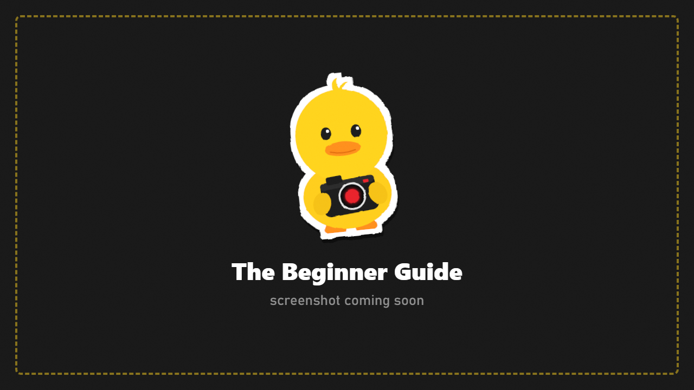

# Installation

## Requirements

- **SPT 4.1** (Escape from Tarkov 0.16.x) with BepInEx, as installed by SPT.
- **Optional:** `ffmpeg.exe` for video recording ([Capture](Capture.md)).
- **Optional:** the **F12 Configuration Manager** (comes with SPT) to change settings outside the game.

## Install {#install}

1. Download the DuckCam zip.
2. Open your **SPT folder** (the one with `EscapeFromTarkov.exe` and the `BepInEx` folder).
3. Extract the zip there. You should end up with:
   ```
   SPT/BepInEx/plugins/DuckCam/DuckCam.dll
   ```
4. Start SPT and load into a raid (or your Hideout).
5. Press **F6**. The raid freezes and the DuckCam menu opens.

The very first time, DuckCam opens the **Beginner Guide**: it asks what you want to do and hides the tabs you won't need. You can run it again any time from **FRAME > Interface**.



## Check that it loaded

Open `SPT/BepInEx/LogOutput.log` and search for:
```
DuckCam 1.0.0 loaded. Toggle: F6.
```
If it isn't there, the DLL is in the wrong place. It must be directly inside `BepInEx/plugins/DuckCam/`.

## Where DuckCam keeps your files {#where-duckcam-keeps-your-files}

Everything you make is stored in `SPT/DuckCam/`, outside the plugin folder, so updating or removing DuckCam never deletes it.

| Folder | What's inside |
|---|---|
| `Screenshots` | Your photos (PNG) and optional JSON info files |
| `Videos` | Recorded MP4 videos |
| `Poses` | Poses saved from Pose Mode or CHARACTERS |
| `Actors` | Saved characters (outfit, gear and pose) |
| `Paths` | Saved camera paths and recordings |
| `Scenes` | Animation timeline scenes |
| `Presets` | Scene presets |
| `Filters` | Your saved looks ("My Filters") |
| `LightRigs` | Saved light rigs |
| `Kits` | Bot spawner kits |
| `Overlays` | Your PNG frames and stickers |
| `Locales` | Translations |

## Video recording (optional) {#video-recording-optional}

DuckCam records MP4 through **FFmpeg**. Put `ffmpeg.exe` in `SPT/BepInEx/plugins/DuckCam/`, or have FFmpeg on your Windows PATH. The CAPTURE tab shows whether it was found.

## Updating

Replace `BepInEx/plugins/DuckCam/DuckCam.dll` with the new one. Your files in `SPT/DuckCam/` stay. Settings in `BepInEx/config` stay too; keys you never changed move to new defaults automatically.

**Coming from the old "SPT Photo Mode" build?** Delete `SPT/BepInEx/plugins/SPT.PhotoMode/` first, or both load and fight over the same keys.

## Uninstall

Delete `SPT/BepInEx/plugins/DuckCam/`. Your photos and saved files stay in `SPT/DuckCam/` until you delete that folder too.
