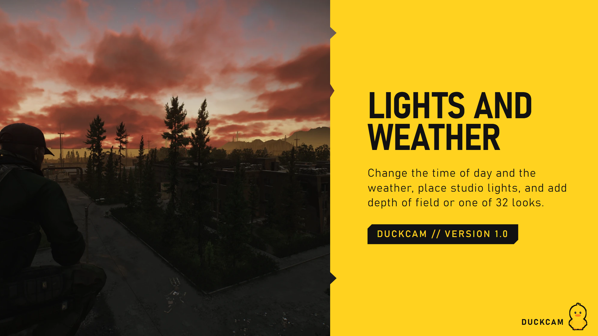
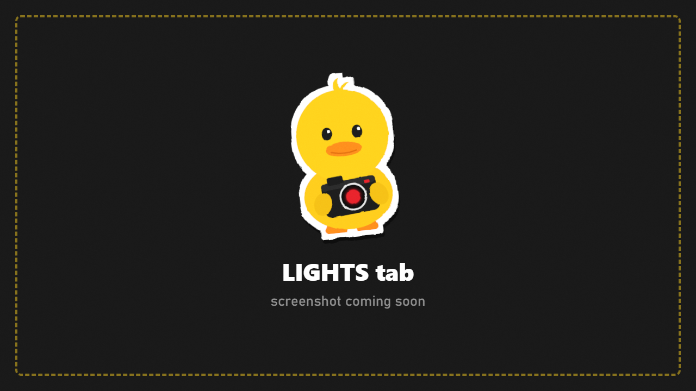

# Lights

Studio lights, an on-camera flash, and light rigs you can reuse.

## Add a light

1. Fly the camera to where the light should be.
2. Choose a **Light Type**: **Point** (shines all around) or **Spot** (a cone).
3. Optional: type a **Light Name**.
4. Press **Create Light > At Camera**. The light appears where the camera is, pointing where it looks.

## Adjust a light

Select a light, then:

| Row | What it does |
|---|---|
| **Intensity** | Brightness |
| **Range** | How far it reaches |
| **Spot Angle** | Cone width (spot lights) |
| **Colour** | Light colour |
| **Shadows** | Whether it casts shadows |
| **Enabled** | Switch it off without deleting it |
| **Move To Camera** | Place it again at the camera |
| **Remove** | Delete it |

## Camera flash

A flash that lights **only the photo**, like a real on-camera flash.

| Row | What it does |
|---|---|
| **Flash** | On / off |
| **Preview Flash** | See the flash on screen while you set it up |
| **Flash Intensity / Range / Spread** | How strong, how far, how wide |
| **Flash Warmth** | Cooler (blue) to warmer (orange) |
| **Flash Shadows** | Hard shadows from the flash |

## Light rigs

Save a group of lights and put it back around any character, on any map.

1. Set up your lights around a character.
2. **Rig Anchor**: save the lights relative to the **camera** or to a **character**.
3. Type a **Rig Name** and press **Save Rig**.
4. Later, load the rig: the lights appear in the same arrangement around the camera or the chosen character.

Rigs are stored in `SPT/DuckCam/LightRigs/`.

> Lights are removed when you leave DuckCam. Save a rig or a [scene preset](Presets.md) to keep them.
