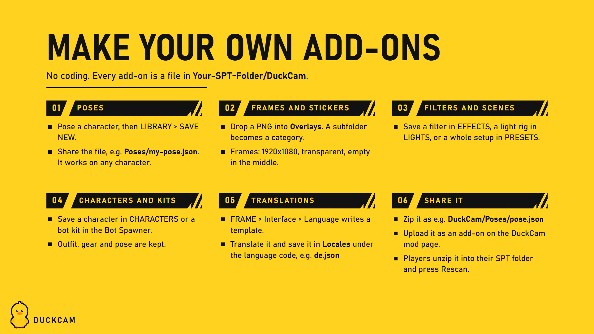

# Making Content

Everything DuckCam saves is a plain file in `Your-SPT-Folder/DuckCam/`, so it can be shared as a small zip. No coding, no Unity. Most of it you make inside DuckCam.



| You want to share | Folder in `Your-SPT-Folder/DuckCam/` | Made with |
|---|---|---|
| Frames and stickers | `Overlays` | Any image editor |
| Poses | `Poses` | Pose Mode or CHARACTERS |
| Colour filters | `Filters` | EFFECTS |
| Scene presets | `Presets` | PRESETS |
| Light rigs | `LightRigs` | LIGHTS |
| Camera paths and recordings | `Paths` | PATHS |
| Animation timeline scenes | `Scenes` | Animation timeline |
| Saved characters | `Actors` | CHARACTERS |
| Bot kits | `Kits` | Bot Spawner |
| Translations | `Locales` | A text editor, see [Translating](Translating.md) |

## Sharing

Zip the folder structure starting at `DuckCam`:
```
DuckCam/Overlays/Film Frames/35mm.png
DuckCam/Poses/Leaning On Wall.json
```
People extract it into their SPT folder so the files land in `Your-SPT-Folder/DuckCam/...`, then press the tab's **Rescan** button or restart the raid.

## Frames and stickers

- PNG or JPG files in `Overlays`. Files directly in the folder show under **General**; each subfolder becomes its own category.
- **Frames** are stretched over the photo frame: transparent PNG at a screen aspect ratio, middle left empty.
- **Stickers** can be any size, with transparency around the shape.
- **OVERLAYS > Overlay Folder > Rescan** picks up new files.

## Poses

1. Freeze, add a character, open Pose Mode (**Ctrl+P**).
2. Pose it, then **SAVE NEW** under LIBRARY (or CHARACTERS > **Save Current Pose**).
3. Share `Poses/<name>.json`.

Poses store bone rotations, so they work on any character: PMC, scav, boss or copy. They appear under **Category > DuckCam**.

## Looks and setups

Filters, scene presets, light rigs, camera paths, timeline scenes, saved characters and bot kits are saved from their tab. Copy the files to share them.
- Scene presets bring back the look, depth of field, frame, time, weather, decorations, flash, camera and lights. Camera and lights load in place on the same map.
- Camera paths and timeline scenes are tied to the map they were made on.
- Saved characters keep outfit, gear and pose. Gear is display-only.

## Poses from your own mod (for mod authors)

DuckCam lists every **Hideout mannequin (Gear Rack) pose** the game knows. Poses another mod adds show up under **Category > From Mods**, marked `[mod]`, with no extra work, the way choccy's Custom Mannequin Poses already do.

1. **Server side:** add the pose to the game's mannequin pose customization like any Gear Rack pose mod does. Its `PoseName` is the key DuckCam uses.
2. **Client side:** have the animation loaded as an `AnimationClip` named exactly that `PoseName`. DuckCam finds it either way:
   - a static `IDictionary<string, AnimationClip>` field in your BepInEx plugin (key = pose name), or
   - any loaded `AnimationClip` with that name.

The clip plays on the same mannequin rig the Hideout Gear Rack uses. Poses that hold a weapon should hold it in the right hand.
