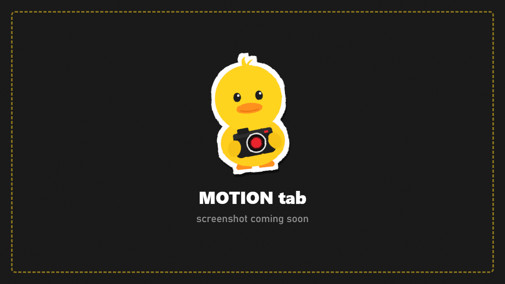

# Motion

How the camera feels when it moves, attaching it to things, and handheld shake.

## Movement feel

| Row | What it does |
|---|---|
| **Move Speed** | Base flying speed. **Mouse5 + wheel** changes it on the fly (shown as **Speed Scale**) |
| **Movement Smoothing** | Higher = the camera glides to a stop instead of stopping dead |
| **Mouse Smoothing** | Smooths mouse look. 0 is raw, around 0.99 is a slow KappaCam-style glide |
| **Sensitivity** | Mouse look speed |
| **Zoom Key Amount** | How far holding **Mouse4** zooms in |

## Attach to a target

Make the camera follow a character, vehicle or object.

1. Look at the target and press **F7** (attach). **Attached To** shows what it locked onto.
2. **Attach Type** chooses between **Look At** (the camera stays where it is and keeps the target in view) and **Parented** (the camera moves with the target).
3. **Turn With Target** decides whether the camera also turns when the target turns.
4. **Anchor On Characters** picks where on a character it attaches: chest, head or feet.
5. **Follow Smoothing** softens the follow so it isn't jerky.
6. **F8** detaches.

## Camera memory

A quick list of camera spots, separate from bookmarks.
- **Add** (or **Home**) stores the current spot.
- **Next** (or **End**) jumps to the next stored spot.
- **Shift+Home** clears the list.

## Handheld shake

A natural, breathing camera wobble for the free camera.

| Row | What it does |
|---|---|
| **Handheld Shake** | On / off |
| **Position Strength / Frequency** | How much and how fast the camera drifts |
| **Rotation Strength / Frequency** | How much and how fast it sways |

Paths and recordings have their own handheld shake in [Paths and Timeline](Paths-and-Timeline.md).
