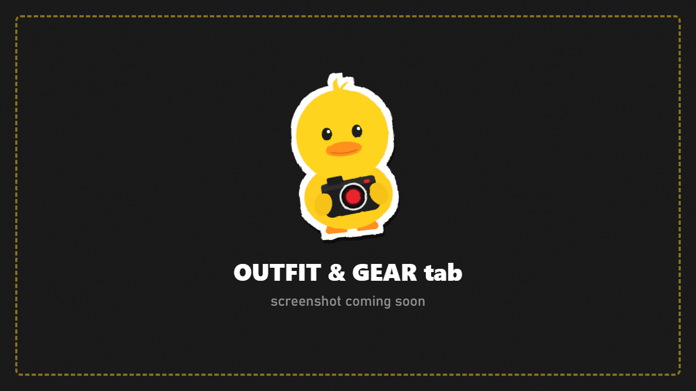
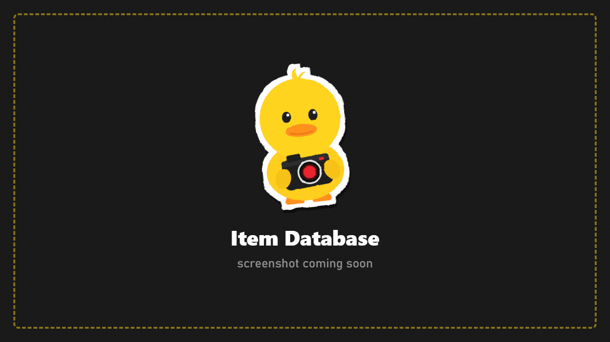

# Outfit and Gear

Dress any photo character: clothes, armor, helmets, rigs, backpacks and weapons. Everything is a **display-only copy**, so nobody's real inventory changes.

## Pick the character

**Character** chooses who you're dressing (any photo character, including bot copies). **Your PMC > Add** adds yourself if you haven't yet.

## Clothes

| Row | What it does |
|---|---|
| **Show** | Which clothes to list: **Matching Side** (USEC or BEAR), **All Sides**, or **Everything** (bot and boss pieces too) |
| **Head** | The head/face |
| **Top** | Upper body clothing |
| **Lower** | Lower body clothing |
| **Reset Outfit** | Back to what they wore |

Each row shows the clothing's in-game name. Modded clothing shows up too.

## Gear

Every equipment slot (headwear, headset, face cover, eyewear, armband, body armor, rig, backpack, primary and second weapon, holster, melee...) can be changed two ways:

- **Quick pickers:** the arrows on each slot list items worn by anyone in this raid, alive or dead, complete with plates and attachments.
- **Item Database > Open:** every item in the game, modded items included, with icons, search and a live preview. Each slot only lists items that fit it.

The pose and position stay put while the new outfit loads.

## Show / hide gear

Hide single pieces without removing them, for example the helmet, the backpack, or the rifle on the back. Toggle **Weapon In Hands** here too.

**Reset Gear** puts every slot back to what the character wore.

> Some armor and rigs are drawn as part of the body's clothing and can't be hidden completely. Helmets that hide hair or a hood don't give it back when hidden.

## Saving

Saved characters (CHARACTERS > **Save**) keep their outfit, gear, hidden pieces and pose.
