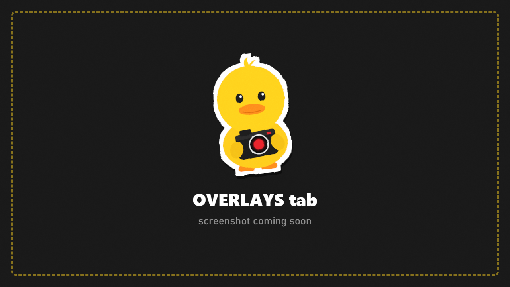

# Overlays

Frames, stickers, text, borders and masks, drawn **into the saved photo** exactly as you see them.

## Frames (your PNG files)

1. Put PNG (or JPG) files in `Your-SPT-Folder/DuckCam/Overlays/`. Files directly in that folder are listed under **General**; every subfolder becomes its own category.
2. Press **Overlay Folder > Rescan**.
3. Pick a **Frame** and set **Frame Opacity**.

Frames are stretched over the photo frame. Use a **transparent PNG** at your screen's aspect ratio (for example 1920x1080 or 3840x2160) with the middle left empty.

## Stickers

1. **Category** and **Sticker** pick an image from your overlay folder.
2. **Add Sticker > Add**.
3. **Edit Sticker** selects which one to change: **Left / Right**, **Up / Down**, **Size**, **Rotate**, **Opacity**.
4. **Remove Sticker** deletes it. **All Overlays > Clear** removes everything.

## Text

1. Press **Add Text**.
2. **Edit Text** picks which text to change.
3. Type in **Text**, then set size, position, **Align**, **Color**, **Bold** and **Shadow**.

## Border

**Border Width** and **Border Color** add a solid or polaroid-style border.

## Mask

An oval, circle or rounded-rectangle mask around the picture: **Mask Size**, **Softness**, **Corner Radius**, **Mask Color**, **Mask Opacity**.

> Frames and stickers are scaled into photos at any resolution. Text, border and mask currently only appear in photos at **Screen** resolution. Transparent photos leave frames and stickers out.
