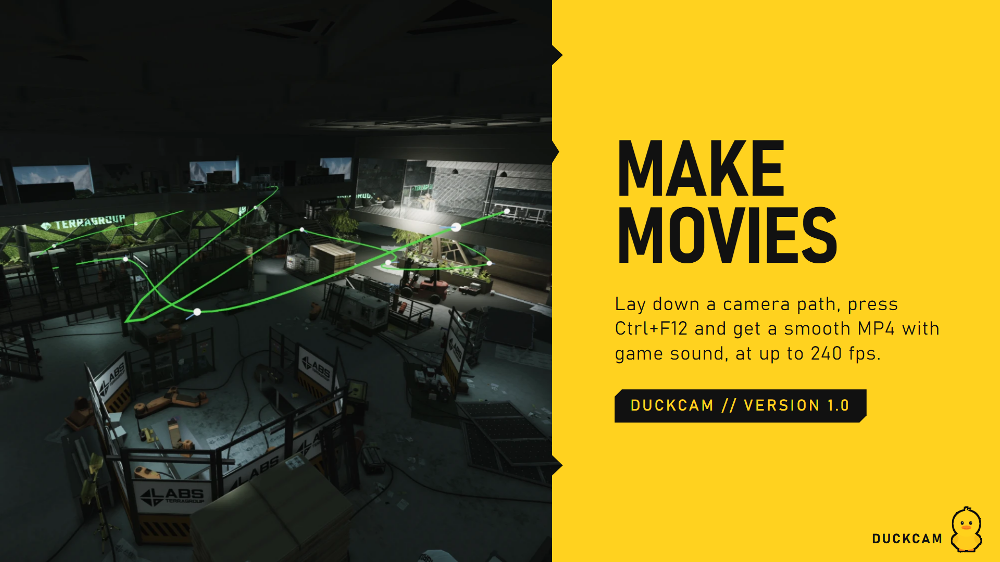
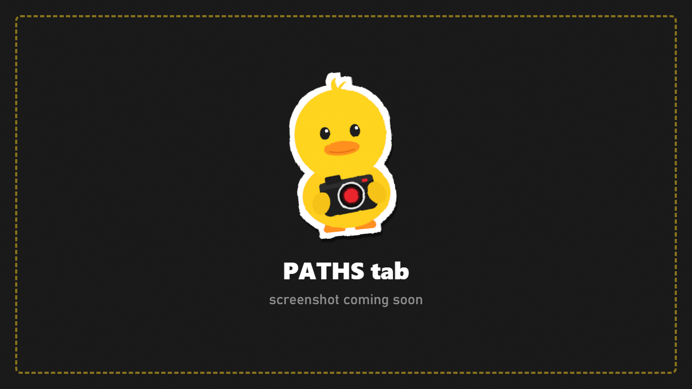

# Paths and Timeline

Three ways to move the camera (and characters) over time:

| | Best for |
|---|---|
| **A. Keyframe path** | Smooth, precise camera moves you can edit point by point |
| **B. Camera recording** | A hand-held feel: you fly, DuckCam remembers exactly how |
| **Animation timeline** | Animating characters' poses and the camera together, SFM style |

## A. Keyframe path

A path is a smooth Bezier curve through spots you choose. At every keyframe the camera looks where you were looking when you added it.

### Make a path

1. Fly the camera to where the shot should **start**.
2. Press **Add Keyframe** (or **Insert**).
3. Fly to the next spot and press it again. Repeat for as many spots as you like.
4. Press **Play**. The camera glides through every keyframe. **Stop** ends it.

### Timing

| Row | What it does |
|---|---|
| **Timing** | **Whole Path Duration**: you set the total time. Or per-point speeds (below) |
| **Path Duration** | Total length in seconds (up to 3600 s) |
| **Constant Speed** | Same speed along the whole path, however far apart the points are |
| **Ease In / Ease Out** | Gentle start / gentle stop |
| **Loop** | Plays forever |
| **3 s Countdown** | A 3-second countdown before playing, handy when recording video |

Per point you can also set: base speed, speed for the stretch after it, **Speed Up Leaving**, **Slow Down Arriving**, **Wait Here** (pause at that point), plus start and end delays.

### Fix a point

- **Edit Points On Screen** shows numbered tags in the world. **Drag a tag** to move that point. **Shift** while dragging changes its height.
- Or pick a keyframe in the list and press **Edit**:
  - **Follow Camera**: the point follows your camera until you stop it. Fly it into place.
  - **Yaw / Pitch / Roll / Field Of View**: type exact values.
  - **Set From Camera** copies the current camera; **View From Key** jumps the camera to that point.
- **Insert Before / Insert After** add points in the middle. **First / Previous / Next / Last** walk through them.
- **Delete** removes the selected keyframe. **Clear Path** removes all.

### Curve shape

| Row | What it does |
|---|---|
| **Manual Handles** | Off = automatic smooth curve. On = drag each point's handles (dots) on screen |
| **Curve Smoothness** | How round the automatic curve is |
| **Separate In/Out Handles** | Different handle lengths on each side. **Alt** while dragging splits them |
| **Handle Length** | Handle size |
| **Aim Handle With Camera** | Points the handle where the camera looks |

### Several paths

**Active Path** picks the path you're editing. **New Path** and **Duplicate** make more. While a path plays, **Alt+1 to Alt+9** cut to path 1-9 at the same progress, like switching cameras in a film.

### Show Path In World

Draws the path line in the scene so you can see where the camera will go.

## B. Camera recording

1. Press **Record** (or **F2**) and fly the camera by hand.
2. Press **F2** again to stop. **Shift+F2** continues the same take.
3. Press **Play** (or **F3**). The camera repeats your exact flight.

**Loop Recording** repeats it; **Play In Real Time** plays it at the speed you flew.

## Handheld shake on paths

A separate shake section adds a subtle hand-held wobble while a path or recording plays.

## Save and load

Type a **File Name**, then **Save Path** or **Save Recording**. They're stored in `SPT/DuckCam/Paths/` and load on the same map. Paths are tied to positions on the map they were made on.

## Animation timeline (Ctrl+T) {#animation-timeline-ctrlt}

An SFM-style timeline that keyframes **the camera and every character's whole pose** over time.

1. Freeze the raid and add your characters ([Characters](Characters.md)).
2. Open the timeline with **Ctrl+T** (or **Animation Timeline > Open** in PATHS).
3. Move the playhead to a time.
4. Pose your characters ([Pose Mode](Pose-Mode.md)) and place the camera.
5. Press **KEY ALL** (or **KEY CAMERA** / **KEY CHARACTER**).
6. Move the playhead, change the pose or camera, key again.
7. **Ctrl+Space** plays / pauses. Drag keys to retime them.

- Each key has an ease: smooth, linear, ease in, ease out or step.
- Stopping on a time makes that pose editable in Pose Mode.
- Save scenes to `SPT/DuckCam/Scenes/`.
- Record it with **Ctrl+F12** for smooth video at any frame rate ([Capture](Capture.md)).

## Making a video from a path

See the full guide: [A smooth camera move video](Guides.md#7-a-smooth-camera-move-video).
