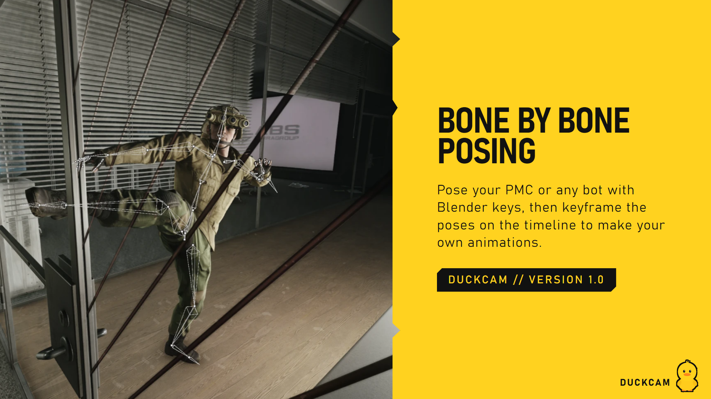
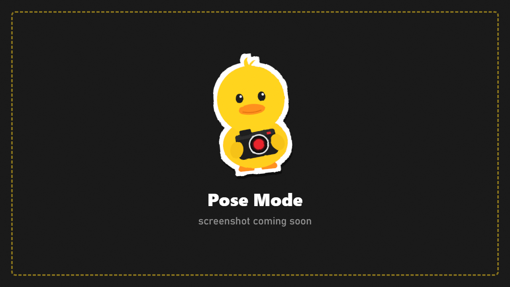

# Pose Mode

A Blender-style pose editor: pose any character bone by bone, with gizmos, IK, mirroring, undo and a pose library. If you know Blender's Pose Mode, you already know the keys.

## Open it

1. Press **F6** to freeze the raid (Pose Mode needs a frozen scene).
2. Press **Ctrl+Tab** (or **Ctrl+P**, or CHARACTERS > **Pose Bone By Bone**).
   - If you have no character yet, your PMC is added as a photo copy and your real PMC is hidden while the copy stands in its place.
3. A help panel opens the first time. **F1** or the **?** button shows it again.
4. **Ctrl+Tab** again (or **Esc**) leaves Pose Mode.

While Pose Mode is on, DuckCam's own camera and menu keys pause so the Blender keys work.

## The screen

- **The skeleton** is drawn as Blender-style bones over the character. Selected bones are blue; the active bone is light blue.
- **The panel** (left):
  - Tool buttons: **TWEAK**, **MOVE**, **ROTATE**, **GLOBAL / LOCAL**, **MIRROR**, **GIZMO**
  - **UNDO**, **REDO**, **POSE ON / OFF**, **RESET ALL**
  - **BONES**: bone groups (TORSO, HEAD, ARM.L, ARM.R, FING.L, FING.R, LEG.L, LEG.R, TWIST) and a searchable bone tree
  - **BONE**: the selected bone's rotation as numbers you can drag or click to type
  - **OPTIONS**, **POSE TOOLS** and **LIBRARY**
- **The hint bar** at the top lists the most useful keys.

## Select bones

| Do this | Result |
|---|---|
| Click a bone (its line or the white dot at its joint) | Select it |
| **Shift+click** | Add to the selection |
| Drag on empty space (or **B**) | Box select. Shift adds, Ctrl removes |
| **A / Alt+A / Ctrl+I** | Select all / none / invert |
| **[ / ]** | Select the parent / child bone (Shift extends) |
| **Ctrl+Shift+M** | Select the mirrored bones |
| Click a group button | Show / hide that group of bones. Shift+click selects the whole group |
| Click a name in the bone tree | Select that bone |

## Rotate and move

1. Select bones.
2. Press **R** and move the mouse to rotate.
   - **X / Y / Z** locks to an axis. Press it **twice** for the bone's own (local) axis.
   - **Shift+X/Y/Z** locks to a plane. **C** frees it again.
   - Type a number for exact degrees: **R X 45 Enter**.
   - Hold **Ctrl** to snap to 5 degrees, **Shift** for fine control.
   - **R R** (press R again) switches to a free trackball rotation.
3. **Left click / Enter / Space** keeps it. **Right click / Esc** cancels.

**G** moves. Only the **Hips (Pelvis)** can move, because game bones are rotation-only. With **AUTO IK (PINS)** on, **G** on a hand or foot moves it and the arm or leg follows.

### Gizmos

Pick **ROTATE** or **MOVE** in the panel to get on-screen handles:
- **Rotate:** drag the red (X), green (Y) or blue (Z) ring, the outer white ring (around the view), or the inside of the gizmo for a free tumble.
- **Move:** drag an axis arrow or the centre.
- **GLOBAL / LOCAL** switches the gizmo between world axes and the bone's own axes.

Dragging directly on a bone also rotates it (the Hips move).

## Clear, undo, copy

| Key | Action |
|---|---|
| **Alt+R / Alt+G** | Clear rotation / location of the selected bones |
| **Ctrl+Z / Ctrl+Shift+Z** (or Ctrl+Y) | Undo / redo |
| **Ctrl+C** | Copy the selected bones' pose (exactly as you see it) |
| **Ctrl+V** | Paste it, also onto another character |
| **Ctrl+Shift+V** | Paste mirrored (left arm onto right arm, and so on) |
| **RESET ALL** (press twice) | Clear every edit and go back to the pose underneath (for example the raid stance or a saved pose) |

## Hide bones

**H** hides the selected bones, **Shift+H** hides all the others, **Alt+H** reveals everything. Hidden groups show as dark buttons; click one to bring it back.

## Camera in Pose Mode

| Input | Action |
|---|---|
| **Middle mouse** drag | Orbit around the selection |
| **Shift + middle mouse** | Pan |
| **Ctrl + middle mouse** or **wheel** | Zoom |
| Hold **right mouse** + **WASD** (R/F up/down, wheel = speed) | Fly |
| **Home** | Frame the whole character |
| **`** | View menu |

## Right-click menu

A right **click** (or **W**) opens the pose menu with the most common commands, each with its shortcut beside it: clear rotation/location, copy/paste, select parent/child/mirror, hide/reveal, frame selected/all.

## Options

| Option | What it does |
|---|---|
| **BASE: ANIMATION / REST POSE** | Edit on top of the current animation, or on the model's bind pose |
| **WRIST TWIST SPREAD** | Spreads hand twist over the forearm like the community Blender rigs, for natural wrists |
| **AUTO IK (PINS)** | G on a hand or foot moves it and pins it; the limb follows |
| **WINDOW** | Panel opacity |
| **1ST PERSON** | Look through the character's eyes while posing |
| **WEAPON GIZMO** | (when holding a weapon) G moves and R rotates the weapon itself. Click a bone to go back to bones |
| **RESET WEAPON** | Put the weapon back in the hand where the pose had it |

## Pose tools

- **COPY POSE / PASTE / PASTE FLIPPED**: same as Ctrl+C / Ctrl+V / Ctrl+Shift+V.
- **T POSE / A POSE**: start from a neutral pose. RESET ALL goes back to the pose underneath.
- **HAND PRESETS** (select an arm or finger bone): **Open**, **Relaxed**, **Fist**, **Point**, **Grip**.

## Library

Type a name and press **SAVE NEW** to save the whole visible pose to `Your-SPT-Folder/DuckCam/Poses/`. Load poses from the list, on any character. Saved poses also appear in CHARACTERS under **Category > DuckCam**.

## Weapons while posing

When a character holds a weapon, it follows the **right hand**: pose the arm and the gun goes with it. Use **WEAPON GIZMO** to fine-tune where it sits in the hand.

## Taking the photo

Press **F11** to hide everything, then **P**.

## Shortcuts {#shortcuts}

| Key | Action |
|---|---|
| LMB / Shift+LMB | Select / add; drag on empty space = box select |
| LMB drag on a bone | Rotate it (the Hips move) |
| B | Box select |
| A / Alt+A / Ctrl+I | Select all / none / invert |
| [ / ] (Shift: extend) | Select parent / child |
| Ctrl+Shift+M | Select mirrored bones |
| R (R again = trackball) / G | Rotate / move (Hips, or pinned limbs with Auto IK) |
| X Y Z (twice = local), Shift+X/Y/Z, C | Axis lock, plane lock, free |
| 0-9 . - | Type an exact value |
| Ctrl / Shift (held) | Snap 5 degrees or 5 cm / fine control |
| LMB, Enter, Space / RMB, Esc | Confirm / cancel |
| Alt+R / Alt+G | Clear rotation / location |
| H / Shift+H / Alt+H | Hide selected / hide others / reveal |
| Ctrl+C / Ctrl+V / Ctrl+Shift+V | Copy / paste / paste mirrored |
| Ctrl+Z / Ctrl+Shift+Z (or Ctrl+Y) | Undo / redo |
| MMB / Shift+MMB / Ctrl+MMB / wheel | Orbit / pan / zoom |
| Hold RMB + WASD | Fly |
| RMB click or W | Pose menu |
| ` / Home | View menu / frame all |
| , / Ctrl+` | Orientation menu / show-hide gizmos |
| F1 | Help panel |
| Esc | Cancel, close a menu, then leave Pose Mode |
| Ctrl+Tab / Ctrl+P | Enter / leave Pose Mode |
| F11, then P | Hide the UI, take the photo |

> On some keyboard layouts (Nordic, German...) `[`, `]` and `` ` `` sit on other keys or need AltGr. The right-click menu and the bone list do the same jobs.

## Good to know

- Tarkov heads have no face rig, so there are no eye or facial expression controls.
- Poses are shown on photo copies, never on your real character.
