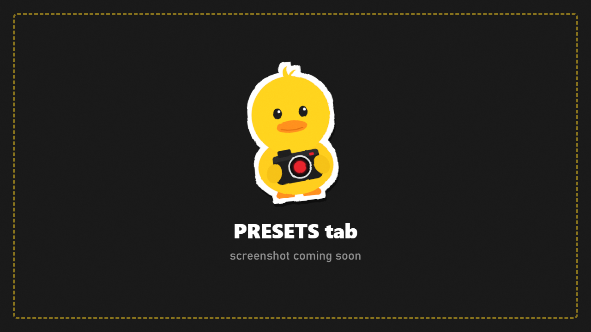

# Presets

Save a whole shot setup and bring it back later, or reset everything.

## Save a scene preset

A scene preset stores: effects and filter, depth of field, frame and grid, time and weather, text, border and mask, flash, **camera position** and **lights**.

1. Set up your shot.
2. Type a **Preset Name**.
3. Press **Save Scene Preset**.

Presets are plain files in `Your-SPT-Folder/DuckCam/Presets/`, easy to back up or share.

## Load a preset

1. Pick the preset under **Load**.
2. Choose what to bring back:
   - **Load Camera Position**: put the camera where it was (same map only).
   - **Load Lights**: recreate the lights. On the same map they go where they were; on another map they're placed around your camera.
3. Load it.

## Reset

Both reset buttons keep you in DuckCam:
- **Reset Everything To Default** puts every look, lens, frame, time, weather and speed setting back.
- The second button also clears characters, studio lights and DuckCam-only bots.
