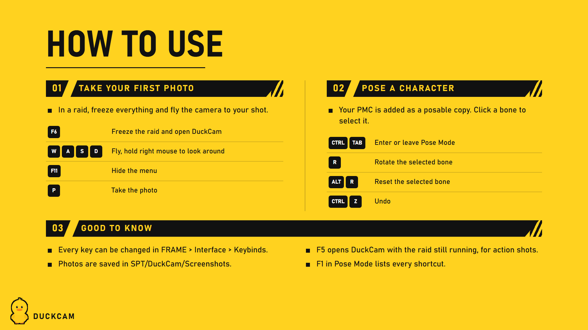
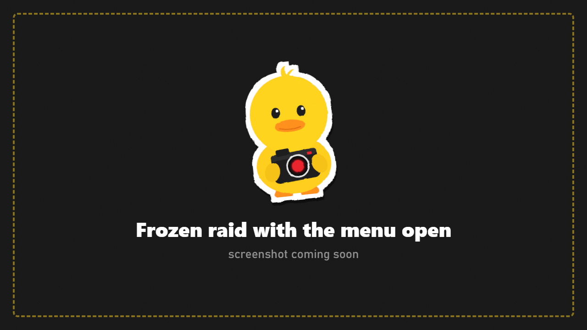

# Quick Start

Your first DuckCam photo in about two minutes.

## 1. Freeze the raid

Load into a raid and press **F6**. Everything stops: bots, bullets, physics, the raid clock. Nobody can be hurt while you're in DuckCam, and your character won't move.

> Want the raid to keep running instead? Press **F5** for a live session. Press F6 inside it to freeze and unfreeze.

## 2. Move the camera

| Do this | To |
|---|---|
| **W A S D** | fly |
| **R / F** | go up / down |
| Hold **right mouse button** + move mouse | look around |
| **Mouse wheel** | zoom (field of view) |
| Hold **Shift** | fly faster |

The camera can go anywhere, but by default it stays within a radius of your PMC and doesn't pass through walls. Both can be changed in [Camera](Camera.md).

## 3. Find a look (optional)

Press **E** a few times to reach **EFFECTS**. Use the arrow keys (or click the arrows) on **Preset** to try looks like *Filmic*, *Noir* or *Golden Hour*.

## 4. Hide the menu and take the photo

- Press **Tab** (or **F11**) to hide the menu.
- Press **P** to take the photo. With the menu open, **Space** also takes it.

The photo is saved as a PNG in `SPT/DuckCam/Screenshots/`, with no UI in it. A message at the top right shows the file name.

## 5. Leave DuckCam

Press **Esc**, then **Leave** in the "Leave DuckCam?" window (or press F6 again). The raid continues exactly where it stopped, and every change DuckCam made (effects, time, weather, camera) is put back.

## Next steps

- Put yourself in the shot: [Pose your PMC](Guides.md#2-pose-your-pmc)
- Bigger photos and transparent backgrounds: [16K and transparent photos](Guides.md#9-16k-photos-and-transparent-backgrounds)
- A smooth camera move: [Camera path video](Guides.md#7-a-smooth-camera-move-video)
- Every key: [Controls and Keybinds](Controls-and-Keybinds.md)
