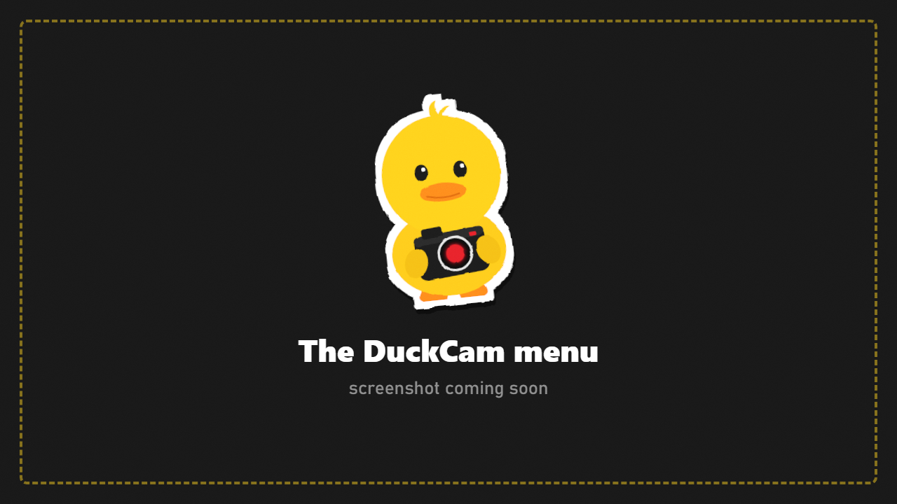

# The Menu

## Layout

- **Tab icons** across the top. The current tab's name is shown in large red letters above them.
- **Rows** below. Each row has a name on the left and its control on the right: a value with arrows, a slider, a toggle or a button.
- A **controls legend** bottom left and a **hint bar** along the bottom show the keys that work right now.
- Long tabs scroll with the mouse wheel over the panel, or with the scrollbar on the right.

## Using it

| Mouse | Keyboard |
|---|---|
| Click a tab icon | **Q / E** |
| Click a row's arrows, drag a slider, click a button | **Up / Down** to pick the row, **Left / Right** to change it, **Enter** to press it |
| Scroll over the panel | |

## How-To on every tab

Every tab starts with a **How-To** row. Press **SHOW** for a short numbered list of what the tab does and how to use it. Press **HIDE** to fold it away again.

## Show or hide tabs

Only need a few tabs? **FRAME > Interface > Tabs** lets you hide any tab. **FRAME** itself always stays, so you can bring them back. The [Beginner Guide](Installation.md#install) can also hide tabs for you based on what you want to do.

## Interface settings (FRAME > Interface) {#interface-settings-frame--interface}

| Row | What it does |
|---|---|
| **Colour scheme** | One of four colour schemes for the menu |
| **Panel side** | Menu on the right or left of the screen |
| **UI Scale** | Bigger or smaller menu |
| **HUD Decorations** | The thin lines and corner marks around the screen |
| **Edge Glow** | The coloured glow at the screen edges |
| **Controls Legend** | The key list bottom left |
| **Tabs** | Show or hide tabs |
| **Keybinds** | Change any DuckCam key |
| **Language** | Pick a translation, rescan the folder, or write a translation template |
| **Beginner Guide** | Run the first-time guide again |
## Leaving DuckCam

**Esc** opens a small **Leave DuckCam?** window in the middle of the screen. **Leave** exits and restores everything; **Stay** goes back. The confirmation can be turned off in the F12 config.
