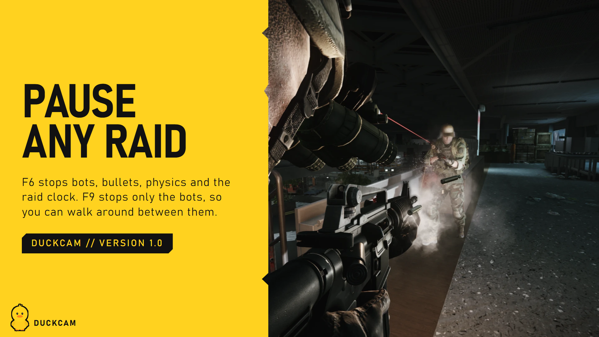

# Time

Freezing, stepping, bots-only freeze, slow motion and live-session safety.

## Frozen vs live

| | **Frozen** (F6) | **Live** (F5) |
|---|---|---|
| Bots, physics, bullets | Stopped | Running |
| Raid clock | Paused (time is given back when you leave) | Running |
| You can be hurt | No | Only if **Live Damage Protection** is off |
| Your PMC | Doesn't move | Can keep playing (F1 switches control) |

**Scene** shows which one you're in. **Resume Raid > Unfreeze** switches a frozen session to live, and F6 inside a live session freezes it.

## Step Frames

Let the world run a few frames, then freeze again. Perfect for catching a grenade mid-air or a bot mid-step.
1. Set **Frame Step Count** (1 or more frames).
2. Press **Step Frames > Step**.

## Freeze Bots Only (F9)

Every bot stops in its exact pose (AI, movement, animation, shooting), while you, time, weather and physics keep going. You can walk right up to them.
- Their AI is **not reset**. While frozen they hear nothing and ignore footsteps, shots, hits and bodies. When released they carry on and only react to what they can see from then on.
- **Frozen Bots Can't Be Hurt** (on by default) protects them while frozen.
- F9 again, or the raid ending, releases them.

> Release them while they can see you and they will react like any bot would. Move out of sight first.

## Speed

| Row | What it does |
|---|---|
| **Slow Motion** | Slows the whole raid (live sessions). **F4** toggles it |
| **Game Speed** | How slow, in percent |
| **Raid Clock Follows Speed** | The raid timer also slows down, so slow motion doesn't eat your raid time |
| **Raid Time Saved** | How much raid time DuckCam has given back so far |

## Live session controls

| Row | What it does |
|---|---|
| **Mouse Controls Camera** | Mouse and WASD drive the camera, not your PMC. **F1** switches |
| **Block PMC Keys** | Stops camera keys (Space, Ctrl, Q, E...) from also making your PMC jump, crouch or lean |
| **Live Damage Protection** | Shows whether you're protected while unsnapped |

## Session > End

Leaves DuckCam and undoes every change.
