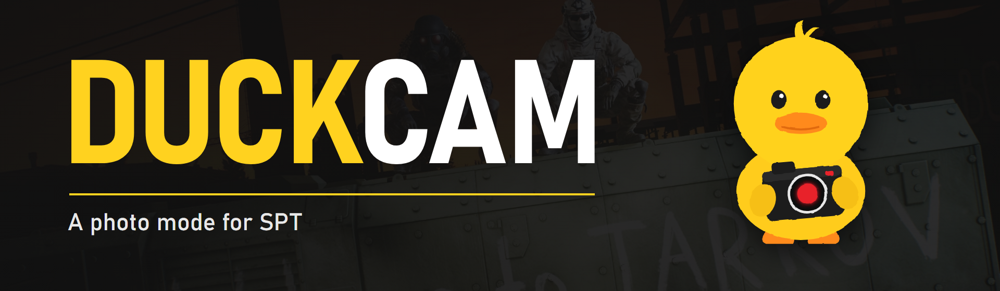
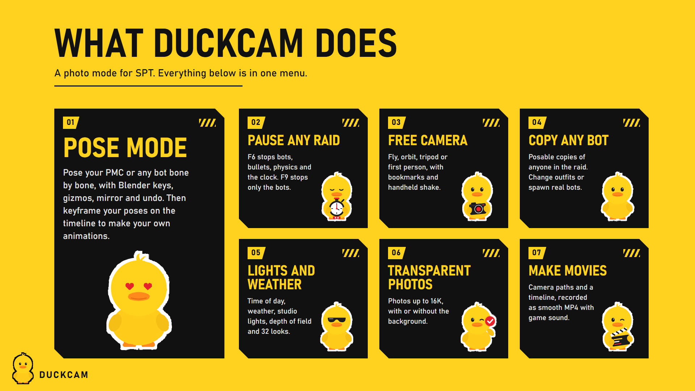
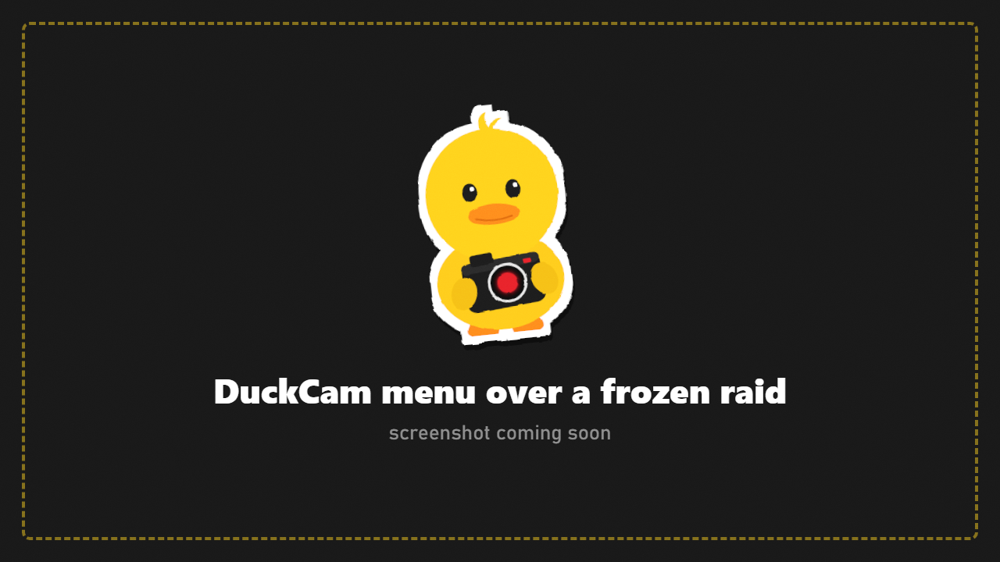

This wiki is a WIP and is being updated every day. If a page you are interested in isn't finished, check back later!

# DuckCam Wiki

**DuckCam** is a photo mode for **SPT 4.1** (Escape from Tarkov 0.16). Freeze a raid in place, fly the camera anywhere, pose characters bone by bone, add bots, change the light and the weather, and take clean screenshots up to 16K or record smooth video.

## Start here

| | |
|---|---|
| **[Installation](Installation.md)** | Put DuckCam in your SPT folder and check it loads |
| **[Quick Start](Quick-Start.md)** | Your first photo in two minutes |
| **[Controls and Keybinds](Controls-and-Keybinds.md)** | Every default key, and how to change them |
| **[The Menu](The-Menu.md)** | How the menu works: tabs, rows, How-To, hiding tabs |
| **[Step-by-Step Guides](Guides.md)** | Posing, squad photos, camera paths, video, 16K and transparent photos |
| **[Troubleshooting and FAQ](Troubleshooting-and-FAQ.md)** | Something is off? Start here |

## What DuckCam can do

**Freeze and time**
- Freeze the whole raid: bots, physics, the raid clock and the sky stop. Nobody can be hurt while frozen.
- Or open DuckCam **live** and keep playing while the camera films.
- **Freeze Bots Only:** every bot stops in its exact pose while you keep walking around them.
- Step a few frames forward, slow motion, game speed.

**Camera**
- Free, Orbit, Tripod and First Person cameras. Look through any player's or bot's eyes.
- KappaCam-style tools: attach to objects, smooth zoom, glide, camera memory, handheld shake, bookmarks.
- Bezier **camera paths** with per-point timing, plus hand-flown camera recordings.

**Look**
- 27 built-in colour filters, 32 looks (Filmic, Noir, Golden Hour, Night Vision, Thermal...) and your own saved filters.
- Live depth of field with autofocus, plus a multi-frame lens render for real bokeh.
- Time of day and weather override. Studio lights and an on-camera flash. Light rigs you can reuse.

**Characters**
- Posable copies of your PMC and of any player or bot in the raid.
- Gear Rack poses, poses from other mods, the game's own body animations, your saved poses.
- **Pose Mode:** a Blender-style pose editor with gizmos, IK, mirror, undo and a pose library.
- Change outfits and gear from an Item Database with every item in the game, modded items included.
- Spawn real bots exactly where you click, with their gear and weapons, or add photo-only bots.

**Capture**
- Clean screenshots with no UI, from screen size up to **16K**, optional **transparent background**.
- Frames, stickers, text, borders and masks baked into the photo.
- MP4 video with game audio through FFmpeg, locked to the frame rate so it is always smooth.

**Everything is undone when you leave.** Every change DuckCam makes is recorded and put back when you exit, when the raid ends, or if something fails.

## Make and share your own content

Poses, filters, scene presets, light rigs, camera paths, saved characters, bot kits, frames, stickers and translations are plain files. See **[Making Content](Making-Content.md)** and **[Translating](Translating.md)**.

## Tabs

[Camera](Camera.md) - [Motion](Motion.md) - [Time](Time.md) - [Paths and Timeline](Paths-and-Timeline.md) - [Depth of Field](Depth-of-Field.md) - [Effects](Effects.md) - [Lights](Lights.md) - [Environment](Environment.md) - [Characters](Characters.md) - [Outfit and Gear](Outfit-and-Gear.md) - [Overlays](Overlays.md) - [Frame](Frame.md) - [Presets](Presets.md) - [Capture](Capture.md) - [Debug](Debug.md)

Deep dives: [Pose Mode](Pose-Mode.md) - [Bot Spawner](Bot-Spawner.md)
